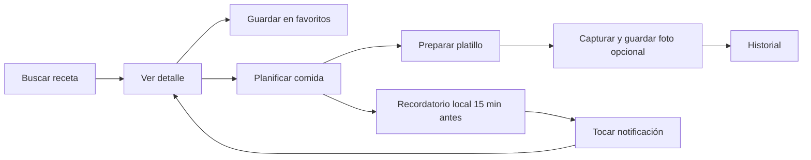
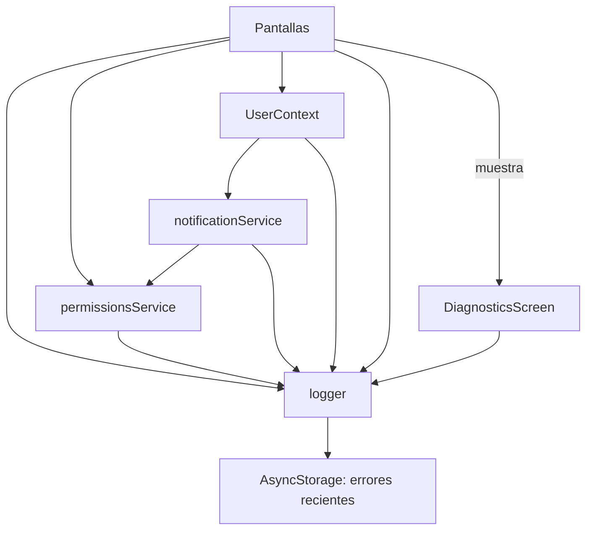

# FoodPlanner App 🥗🥘

Aplicación móvil (React Native + Expo) para **buscar recetas, guardar favoritas y organizar un plan semanal de comidas**, respetando la dieta y las alergias de cada usuario.

Proyecto del curso *Desarrollo de Aplicaciones Móviles* (proyecto 5 de la guía: FoodPlanner).

## 🎯 Estado del proyecto

| Avance | Estado | Alcance |
| ------ | ------ | ------- |
| **APF1** (semana 5) | ✅ Entregado y mejorado | Estructura, interfaz, props, estado, formulario validado y navegación |
| **APF2** (semana 10) | ✅ Entregado | Hooks, consumo de API, estados loading/error/vacío y AsyncStorage |
| **APF3** (semana 15) | ✅ Completado | Cámara y permisos, notificaciones locales, manejo de errores y logging, validaciones, integración global y documentación |

## ✨ Funcionalidades actuales

- **Registro e inicio de sesión** con validación y mensajes de error visibles bajo cada campo.
- **Onboarding** (dieta → alergias). Desde el Perfil se pueden editar las mismas preferencias.
- **Inicio (conectado a la API):** recetas por categoría y búsqueda por nombre, con fotos reales. Muestra **cargando**, **error con botón de reintentar** y **estado vacío**. Se filtra según la dieta y alergias del usuario.
- **Detalle de receta (conectado a la API):** muestra al instante el nombre y la foto, y carga ingredientes y pasos. Avisa si la receta contiene algo que el usuario marcó como alergia.
- **Traducción al español (bajo demanda):** en el detalle, el botón **Traducir al español** traduce ingredientes y pasos (la API solo entrega inglés); el nombre del plato se conserva porque es un nombre propio. Muestra "Traduciendo...", mensajes de error con reintento y un aviso de que es traducción automática. Cada receta se traduce una sola vez: el resultado queda guardado en el celular y después se alterna con **Ver original / Ver en español** sin gastar cupo.
- **Favoritos:** el corazón funciona en Inicio, Detalle y Favoritos; los filtros se arman con las categorías de tus favoritos.
- **Vistas recientemente:** las últimas recetas que abriste aparecen en Inicio para volver a ellas rápido.
- **Todo se guarda en el celular (AsyncStorage):** la sesión, la dieta y alergias, los favoritos, las recetas vistas, el plan semanal, el historial de preparaciones y los ajustes. Al cerrar y abrir la app sigues dentro y no pierdes nada.
- **Plan semanal (persistente):** calendario de 19 días con 4 comidas por día (desayuno, almuerzo, snack, cena). Se agregan recetas desde el **detalle** ("Añadir al Plan Semanal": eliges día y comida) o desde el **Plan** (eliges entre tus favoritas y vistas). Se pueden abrir y quitar; los días con comidas se marcan con un punto y se muestra cuántas comidas del día están planificadas. Se guarda en AsyncStorage por usuario.
- **Registro de preparación e historial (persistentes):** al completar una comida del Plan (o desde el botón de cámara de una receta) se abre el registro y "Guardar en mi Historial" guarda la preparación con fecha, hora y foto opcional capturada con la cámara del dispositivo. Las fotos quedan en el almacenamiento privado de la app y se eliminan al borrar el registro. El **Historial** separa *Plan Semanal* y *Cocina Libre*, muestra estado vacío y permite borrar registros; en el Plan, la comida completada queda marcada como "Hecho".
- **Perfil y ajustes (persistentes):** cierre de sesión que limpia el estado del usuario. En Configuración, al activar las notificaciones se solicita el permiso del sistema; los recordatorios solo se pueden activar con ese permiso concedido. Si apagas las notificaciones o el sistema revoca el permiso, los recordatorios quedan desactivados.

## Permisos

Los permisos se solicitan cuando se necesita la función. La aplicación vuelve a consultar el estado al regresar al primer plano para reflejar cambios hechos desde los ajustes del dispositivo.

| Permiso | Cuándo se pide | Si se acepta | Si se rechaza o bloquea |
| ------- | -------------- | ------------ | ----------------------- |
| Cámara | Al entrar en el registro de preparación | Se activa la vista previa para fotografiar el platillo; la foto es opcional | Si se puede volver a preguntar, aparece **Volver a intentar**; si está bloqueado, aparece **Abrir ajustes**. El registro se puede guardar sin foto |
| Notificaciones | Al activar **Notificaciones Push** en Configuración | Se activa el ajuste y se pueden habilitar los recordatorios | Si se puede volver a preguntar, el aviso ofrece **Volver a intentar**; si está bloqueado, ofrece **Abrir ajustes**. El ajuste queda apagado |

## Notificaciones

Los recordatorios son notificaciones locales para las comidas del Plan Semanal. Al planificar una receta, se agenda un aviso 15 minutos antes de la hora de esa comida. Al tocarlo, se abre la receta; si no incluye una receta, se abre el Plan. El botón **Enviar notificación de prueba** permite comprobar el permiso y la entrega con un aviso a los cinco segundos.

| Evento | Qué ocurre |
| ------ | ---------- |
| Se agrega o cambia una comida del plan | Se programa o reemplaza su recordatorio si están activos **Notificaciones Push** y **Recordatorios de Comida**, y el permiso está concedido |
| Se quita una comida, se registra como preparada o se apagan los ajustes | Se cancela el recordatorio correspondiente o todos los recordatorios del usuario |
| Se inicia sesión o se recupera la sesión guardada | Se sincronizan los recordatorios pendientes; se omiten las comidas registradas en el historial |
| Llega la hora de una comida | Se muestra «Hora de tu …» 15 minutos antes; al tocar el aviso se abre la receta o el Plan |

Las notificaciones locales se prueban en un development build o APK, no en Expo Go.

## Avance 3 y relación con la rúbrica

| Criterio | Implementación existente | Archivos principales | Cómo probar |
| -------- | ----------------------- | -------------------- | ----------- |
| Funcionalidades nativas (25 %) | Cámara real, captura y persistencia privada de fotos en el historial | `PreparationRecordScreen.js`, `HistoryScreen.js`, `expo-camera`, `expo-file-system` | Registrar una preparación, usar la foto, reiniciar la app y revisar el historial |
| Solicitud y gestión de permisos (15 %) | Solicitud contextual de cámara y notificaciones, estados normalizados y acceso a ajustes | `permissionsService.js`, `usePermission.js`, `PreparationRecordScreen.js`, `SettingsScreen.js`, `app.json` | Conceder, denegar y bloquear el permiso desde el teléfono |
| Notificaciones y eventos relevantes (15 %) | Recordatorios locales del plan, notificación de prueba, cancelaciones y navegación al tocar | `notificationService.js`, `UserContext.js`, `AppNavigator.js`, `SettingsScreen.js` | Programar una comida futura, probar, tocar la notificación y retirar la comida |
| Rendimiento, errores y logging (20 %) | Errores de red y almacenamiento controlados, ErrorBoundary, registro central y optimizaciones de listas | `logger.js`, `ErrorBoundary.js`, `DiagnosticsScreen.js`, `HistoryScreen.js`, `RecipeCard.js` | Desconectar internet, revisar Diagnóstico, filtros y recuperación de errores |
| Integración global y documentación (25 %) | Flujo conectado entre recetas, plan, cámara, historial, ajustes y registro; guía técnica y evidencias | `App.js`, `AppNavigator.js`, `UserContext.js`, `README.md`, `docs/capturas/apf3/` | Seguir el flujo integrado y contrastar las capturas indicadas abajo |

Las ponderaciones identifican los criterios de la rúbrica; no representan una medición automática del puntaje.

## Descripción y propósito

FoodPlanner ayuda a personas que organizan comidas semanales a descubrir recetas, considerar sus preferencias y alergias, guardar favoritas y registrar lo que preparan. Las pantallas cubren acceso y registro, preferencias iniciales, Inicio, detalle de receta, Favoritos, Plan, Registro de Preparación, Historial, Perfil y Configuración/Diagnóstico.

### Estado de los avances

| Avance | Estado | Entrega documentada |
| ------ | ------ | ------------------- |
| APF1 (semana 5) | ✅ Entregado y mejorado | Estructura, interfaz, componentes, estado, formularios y navegación |
| APF2 (semana 10) | ✅ Entregado | Hooks, API de recetas y traducción, estados de carga/error/vacío, persistencia local, plan semanal e historial |
| APF3 (semana 15) | ✅ Completado | Cámara y permisos, recordatorios locales, manejo de errores, logging, validaciones, integración y documentación |

## Flujo integrado

El flujo conecta la búsqueda y el detalle de recetas con la planificación y el registro de la comida. El recordatorio se envía si la comida aún no se completó, los ajustes están activos y el sistema concedió el permiso.



## Funcionalidad nativa y permisos

La cámara usa `expo-camera` (`CameraView`) para la vista previa, obturador, cambio entre cámaras frontal y trasera y flash. La foto seleccionada se copia mediante `expo-file-system` a `Paths.document/fotos-preparaciones`; el historial persiste la URI y al borrar el registro intenta borrar el archivo. La cámara solo se solicita al entrar al Registro de Preparación. La prueba funcional descrita para captura y persistencia está marcada abajo; las capacidades de cámara/flash se describen según el código.

| Permiso | Cuándo se solicita | Si se acepta | Si se rechaza | Si queda bloqueado |
| ------- | ------------------ | ------------ | ------------- | ------------------ |
| Cámara | Al entrar al Registro de Preparación | Muestra la vista previa y permite capturar; también se puede guardar sin foto | Se muestra el mensaje alternativo y la opción de volver a intentar | Ofrece abrir los ajustes del sistema; se puede guardar sin foto |
| Notificaciones | Al activar «Notificaciones Push» en Configuración | Permite activar el ajuste y los recordatorios locales | El ajuste queda apagado y se muestra el aviso con opciones de reintento y ajustes | El aviso incluye «Abrir ajustes»; el permiso puede comprobarse de nuevo al volver a la app |

Textos de configuración presentes en `app.json`:

- Cámara, iOS y complemento de cámara: «FoodPlanner necesita acceder a la cámara para fotografiar el platillo preparado.»
- Notificaciones: el complemento declara `enableRemoteNotifications: false`; `app.json` no define un texto de uso personalizado para notificaciones. La explicación al usuario está en la interfaz de Configuración.

## Notificaciones locales

La aplicación programa notificaciones **locales**, no envía notificaciones remotas. `REMINDER_MINUTES_BEFORE` vale 15. En Android se prepara el canal `recordatorios-comidas`, llamado «Recordatorios de comidas», con importancia alta. Los horarios locales de cada comida se definen en `src/data/mealSlots.js`.

| Evento | Acción existente |
| ------ | ---------------- |
| Añadir o reemplazar comida | Programa o reemplaza el recordatorio si los dos ajustes están activos y el permiso está concedido |
| Hora del recordatorio ya transcurrida | Omite la notificación y registra la omisión; la comida se conserva en el plan |
| Quitar comida o registrarla como preparada | Cancela el recordatorio de esa comida |
| Desactivar notificaciones o recordatorios | Cancela los recordatorios del usuario |
| Iniciar o recuperar sesión | Sincroniza comidas futuras y omite las registradas en el historial |
| Tocar notificación | Abre el detalle de la receta cuando hay `recipeId`; de lo contrario, abre el Plan |

`SettingsScreen.js` incluye «Enviar notificación de prueba», que programa un aviso local para unos cinco segundos después. Se necesita development build o APK; Expo Go presenta limitaciones para notificaciones.

## Arquitectura y estructura real

```text
src/
├── components/       # Pantallas base, botones, formularios, tarjetas e ErrorBoundary
├── context/          # UserContext: estado y acciones del usuario
├── data/             # Comidas, categorías, áreas y preferencias
├── hooks/             # Recetas, traducción, permisos y valor con demora
├── navigation/        # AppNavigator, pestañas, rutas y navegación por notificación
├── screens/           # Acceso, Inicio, Plan, detalle, historial, preparación, perfil y ajustes
├── services/          # API de recetas, traducción, permisos y notificaciones
├── storage/           # Persistencia JSON, datos de usuario y caché de traducción
├── theme/             # Paleta de colores
└── utils/              # Logger, validación, fechas del plan, filtros y transformación de recetas
```

Las pantallas presentan y coordinan la interacción; los componentes encapsulan piezas visuales; los hooks agrupan estado reutilizable; los servicios gestionan API y módulos del dispositivo; `UserContext` centraliza estado y acciones; `storage` valida/persiste datos y `utils` reúne lógica compartida.



## Errores, validaciones, registro y rendimiento

Cada evento usa `[fecha ISO] [NIVEL] [módulo] mensaje`; las marcas de tiempo ISO están en UTC. `INFO` registra eventos relevantes, `WARN` condiciones recuperables, `ERROR` fallos y `DEBUG` solo se imprime en desarrollo. El logger conserva hasta 100 eventos recientes en memoria y hasta 50 errores en AsyncStorage; enmascara correos y oculta campos sensibles.

| Módulo | Eventos contemplados en el código |
| ------ | -------------------------------- |
| `app` | Inicio, recuperación/inicio/cierre de sesión y errores globales o del ErrorBoundary |
| `permisos` | Comprobación y solicitud, resultado concedido/denegado/bloqueado/no disponible y fallos |
| `camara` | Captura, guardado, archivo no disponible y eliminación fallida |
| `notificaciones` | Programación, cancelación, omisiones y sincronización con conteos |
| `red` | Tiempo agotado, respuesta HTTP o inválida, cuota del traductor y desconexión |
| `almacenamiento` | Fallos de lectura/escritura/borrado y recuperación con valores por defecto |
| `navegacion` | Errores al leer o limpiar respuestas de notificación |
| `plan` / `historial` | Validación de comida/horario y foto faltante o no cargable |

`ErrorBoundary` registra el error y la pila de componentes y ofrece reiniciar el árbol visual o volver al inicio cuando la navegación está disponible. El manejador global de errores JavaScript también registra el fallo y delega en el manejador previo.

| Pantalla | Validación | Respuesta visible o acción |
| -------- | ---------- | -------------------------- |
| Plan / detalle | Receta con identificador válido | Rechaza recetas sin identificador con un aviso claro |
| Plan / detalle | Confirmar un horario ya ocupado | Pide confirmación antes de reemplazar |
| Plan | Hora del recordatorio ya pasada | Guarda la comida e informa «Este horario ya pasó, no se programará recordatorio» |
| Preparación | Foto persistente existente antes de guardar | Si no existe, avisa y permite guardar sin foto; bloquea doble toque durante el guardado |
| Login / registro | Correo, contraseña y confirmación válidos; campos obligatorios | Muestra errores y no inicia/crea sesión con datos inválidos |
| Preferencias | Selección válida | Informa si falta una selección |
| API / traducción | Espera máxima de 10 segundos y respuestas válidas | Muestra estado de error con reintento; distingue «Sin conexión a internet» |
| Almacenamiento | JSON leído desde AsyncStorage | Si es corrupto, registra el error y retorna valores predeterminados |

Optimizaciones observables: `FlatList` en el Historial (`initialNumToRender` acotado y recorte en Android), `React.memo` en tarjetas de listas, callbacks estabilizados para elementos repetidos, valor de `UserContext` con `useMemo`, imágenes con respaldo y limpieza de suscripciones/listeners en efectos.

La pantalla **Configuración → Diagnóstico → Ver registro de eventos** lista los eventos recientes y permite filtrarlos por nivel. **Borrar registro** requiere confirmación y elimina el registro en memoria y los errores persistidos.

## Casos de prueba APF3

Los estados «Probado» de esta tabla corresponden exclusivamente a los casos indicados como probados en celular. Los demás quedan pendientes de verificación.

| ID | Caso | Pasos | Resultado esperado | Estado |
| -- | ---- | ----- | ------------------ | ------ |
| P01 | Captura y guardado de foto | Capturar, usar foto y guardar registro | El historial muestra la fotografía | ✅ Probado en celular |
| P02 | Foto tras reiniciar | Guardar foto, cerrar y reabrir la app | La foto continúa en el historial | ✅ Probado en celular |
| P03 | Borrar registro con foto | Borrar desde el historial | El registro se elimina y la app intenta borrar el archivo | ✅ Probado en celular |
| P04 | Cámara concedida | Entrar al registro y aceptar | Se muestra vista previa | ✅ Probado en celular |
| P05 | Cámara denegada | Denegar el permiso | Se muestra alternativa con acceso a ajustes/reintento | ✅ Probado en celular |
| P06 | Cámara bloqueada | Bloquear permiso y abrir ajustes | Se ofrece «Abrir ajustes» | ✅ Probado en celular |
| P07 | Notificaciones concedidas | Activar el ajuste y aceptar | El permiso queda concedido | ✅ Probado en celular |
| P08 | Notificaciones denegadas | Denegar al activar el ajuste | El interruptor queda apagado y se informa al usuario | ✅ Probado en celular |
| P09 | Notificación de prueba | Pulsar el botón de prueba | Llega el aviso local en unos segundos | ✅ Probado en celular |
| P10 | Recordatorio planificado | Activar ajustes y planificar comida futura | Llega el recordatorio local | ✅ Probado en celular |
| P11 | Cancelar al quitar comida | Quitar comida planificada | Se cancela su recordatorio | ✅ Probado en celular |
| P12 | Sin conexión | Desconectar internet y cargar recetas | Se ve el mensaje de falta de conexión | ✅ Probado en celular |
| P13 | ErrorBoundary | Provocar una excepción capturable | Aparece la pantalla de recuperación | ✅ Probado en celular |
| P14 | Registro, filtros y borrado | Abrir Diagnóstico, filtrar errores y borrar | Se filtra y se borra tras confirmar | ✅ Probado en celular |
| P15 | Hora ya pasada | Planificar comida para horario transcurrido | Se guarda sin aviso y se informa | ✅ Probado en celular |
| P16 | Cambiar cámara y flash | Probar controles del visor | Cambia la cámara y el flash trasero | ⏳ Por verificar |
| P17 | Repetir foto | Capturar y elegir repetir | Permite tomar otra imagen antes de guardarla | ⏳ Por verificar |
| P18 | Guardar sin fotografía | Denegar cámara y completar el registro | Se registra sin foto | ⏳ Por verificar |
| P19 | Apertura de receta desde aviso | Tocar un recordatorio con receta | Se abre el detalle correspondiente | ⏳ Por verificar |
| P20 | Aviso sin receta | Tocar respuesta de notificación sin identificador de receta | Se abre el Plan | ⏳ Por verificar |
| P21 | Confirmar reemplazo | Planificar sobre un horario ocupado | Se solicita confirmación antes de reemplazar | ⏳ Por verificar |
| P22 | Formulario vacío | Intentar acceder o registrarse sin completar campos | Se muestran errores y no se guarda sesión | ⏳ Por verificar |
| P23 | Datos locales corruptos | Cargar JSON inválido en almacenamiento | La app recupera valores por defecto y registra el error | ⏳ Por verificar |
| P24 | APK instalable | Generar e instalar APK de vista previa | La app abre sin depender del servidor de desarrollo | ⏳ Por verificar |

## Evidencias APF3

Las capturas esperadas se guardan en [`docs/capturas/apf3/`](docs/capturas/apf3/). El índice explica el contenido de cada archivo; las capturas que todavía no estén en la carpeta quedan pendientes de adjuntar.

| Captura | Funcionalidad que debe mostrar |
| ------- | ----------------------------- |
| [01-camara-vista-previa.png](docs/capturas/apf3/01-camara-vista-previa.png) | Vista previa de cámara en el registro |
| [02-foto-capturada-repetir-usar.png](docs/capturas/apf3/02-foto-capturada-repetir-usar.png) | Foto capturada y controles para repetir o usar |
| [03-historial-con-foto.png](docs/capturas/apf3/03-historial-con-foto.png) | Registro del historial con fotografía |
| [04-permiso-camara-dialogo.png](docs/capturas/apf3/04-permiso-camara-dialogo.png) | Solicitud de permiso de cámara |
| [05-permiso-camara-denegado.png](docs/capturas/apf3/05-permiso-camara-denegado.png) | Alternativa tras denegar la cámara |
| [06-permiso-camara-ajustes-sistema.png](docs/capturas/apf3/06-permiso-camara-ajustes-sistema.png) | Permiso de cámara en ajustes del sistema |
| [07-permiso-notificaciones-dialogo.png](docs/capturas/apf3/07-permiso-notificaciones-dialogo.png) | Solicitud de permiso de notificaciones |
| [08-permiso-notificaciones-bloqueado.png](docs/capturas/apf3/08-permiso-notificaciones-bloqueado.png) | Aviso de permiso bloqueado con acceso a ajustes |
| [09-configuracion-notificaciones.png](docs/capturas/apf3/09-configuracion-notificaciones.png) | Interruptores y acción de notificación de prueba |
| [10-plan-con-recordatorio.png](docs/capturas/apf3/10-plan-con-recordatorio.png) | Comida planificada con indicador de recordatorio |
| [11-notificacion-recordatorio.png](docs/capturas/apf3/11-notificacion-recordatorio.png) | Notificación local recibida |
| [12-notificacion-abre-receta.png](docs/capturas/apf3/12-notificacion-abre-receta.png) | Detalle abierto desde la notificación |
| [13-diagnostico-configuracion.png](docs/capturas/apf3/13-diagnostico-configuracion.png) | Acceso a Diagnóstico desde Configuración |
| [14-registro-eventos.png](docs/capturas/apf3/14-registro-eventos.png) | Lista de eventos recientes |
| [15-registro-eventos-filtro-error.png](docs/capturas/apf3/15-registro-eventos-filtro-error.png) | Registro filtrado por errores |
| [16-error-boundary.png](docs/capturas/apf3/16-error-boundary.png) | Pantalla de recuperación del ErrorBoundary |
| [17-sin-conexion.png](docs/capturas/apf3/17-sin-conexion.png) | Mensaje de error por falta de conexión |
| [18-validacion-hora-pasada.png](docs/capturas/apf3/18-validacion-hora-pasada.png) | Aviso al planificar una hora pasada |
| [19-flujo-buscar.png](docs/capturas/apf3/19-flujo-buscar.png) | Búsqueda de recetas en Inicio |
| [20-flujo-detalle.png](docs/capturas/apf3/20-flujo-detalle.png) | Pantalla de detalle de receta |
| [21-flujo-plan.png](docs/capturas/apf3/21-flujo-plan.png) | Receta agregada al Plan |
| [22-flujo-registro-preparacion.png](docs/capturas/apf3/22-flujo-registro-preparacion.png) | Registro de preparación |
| [23-flujo-historial.png](docs/capturas/apf3/23-flujo-historial.png) | Registro visible en el historial |
| [24-apk-instalado.png](docs/capturas/apf3/24-apk-instalado.png) | Aplicación ejecutándose desde APK instalado |

## Instalación, ejecución y builds

Requisitos: Node.js/npm y conexión a internet para instalar dependencias y consultar las API.

```bash
npm install
npx expo start --dev-client
```

La cámara y, especialmente, las notificaciones locales se validan en el development build; Expo Go tiene limitaciones para notificaciones y no representa la configuración nativa completa de la app. Para compilar Android con EAS CLI configurado:

```bash
eas build --platform android --profile development
eas build --platform android --profile preview
```

El perfil `development` genera el cliente de desarrollo. El perfil `preview` distribuye internamente un APK instalable, configurado para ejecutarse sin servidor de desarrollo.

## Limitaciones conocidas y mejoras futuras

- Los recordatorios son locales; no hay envío remoto ni sincronización del sistema operativo con un servidor.
- La entrega puede verse afectada por los permisos y por restricciones de ahorro de batería del dispositivo o fabricante.
- Los horarios de desayuno, almuerzo, snack y cena son valores fijos en `src/data/mealSlots.js`.
- TheMealDB entrega nombres/instrucciones en inglés y la traducción al español es bajo demanda mediante un servicio externo.
- La clasificación de dietas y alérgenos se estima a partir de la categoría y los ingredientes recibidos; no sustituye una verificación nutricional.

## Tecnologías y versiones

Versiones declaradas en `package.json` (rangos conservados tal cual):

| Paquete | Versión declarada |
| ------- | ----------------- |
| Expo | `^58.0.0` |
| React Native | `0.88.1` |
| React | `19.3.0` |
| `expo-camera` | `~58.0.14` |
| `expo-file-system` | `~58.0.13` |
| `expo-notifications` | `~58.1.9` |
| `expo-constants` | `~58.0.16` |
| `@react-navigation/native` | `^7.3.18` |
| `@react-navigation/native-stack` | `^7.18.10` |
| `@react-navigation/bottom-tabs` | `^7.18.18` |
| AsyncStorage | `2.2.0` |
| `@expo/vector-icons` | `^15.1.1` |

Proyecto del curso *Desarrollo de Aplicaciones Móviles*, proyecto 5 de la guía: FoodPlanner. Créditos del equipo/curso: no hay nombres individuales de integrantes documentados en el README original.

## Manejo de errores, validaciones y logging

El registro central está en `src/utils/logger.js`. Cada evento se imprime con el formato `[fecha ISO] [NIVEL] [módulo] mensaje`. Los niveles son **INFO** (eventos importantes), **WARN** (situaciones recuperables), **ERROR** (fallos) y **DEBUG** (solo durante desarrollo). El búfer conserva los 100 eventos recientes en memoria y AsyncStorage conserva hasta 50 errores entre sesiones. Los correos se enmascaran y los campos sensibles se ocultan.

| Módulo | Eventos registrados |
| ------ | ------------------- |
| `app` | Inicio de la aplicación, inicio, recuperación y cierre de sesión (correo enmascarado) |
| `permisos` | Comprobación, solicitud y resultado de permisos; errores al abrir ajustes |
| `camara` | Captura, guardado, archivo ausente o fallido y foto borrada |
| `notificaciones` | Programación, cancelación, omisiones por hora pasada, sincronización y errores (con conteos) |
| `red` | Fallos de consulta, respuesta inválida, espera agotada y falta de conexión |
| `almacenamiento` | Fallos de lectura o escritura y datos corruptos recuperados con valores predeterminados |
| `navegacion` | Fallos al procesar respuestas de notificaciones |
| `plan` / `historial` | Datos inválidos y fotos faltantes en registros |

`ErrorBoundary` captura errores de renderizado, registra el mensaje y la pila de componentes y presenta una pantalla de recuperación con **Reintentar** y, si hay navegación disponible, **Volver al inicio**. Un manejador global registra errores JavaScript no capturados y delega también en el manejador previo de React Native.

| Pantalla o flujo | Validación | Mensaje o respuesta |
| --------------- | ---------- | ------------------- |
| Plan | La receta debe tener un identificador | Se informa que la receta no se puede planificar |
| Plan / Detalle | Un horario ocupado requiere confirmar el reemplazo | Se pide confirmación antes de sustituir la comida |
| Plan | Si la hora ya pasó, se guarda la comida sin programar aviso | «Este horario ya pasó, no se programará recordatorio» |
| Registro de preparación | Se comprueba que el archivo de la foto exista; si falta, permite guardar sin foto | Aviso claro y opción de continuar sin foto |
| Registro de preparación | El botón de guardado se bloquea mientras se guarda | Evita registros duplicados por doble toque |
| Acceso y registro | Campos vacíos o inválidos no se guardan | Error visible junto al formulario o aviso claro |
| Preferencias | Debe elegirse una opción válida | Aviso antes de guardar |
| Servicios de red | Tiempo máximo, errores HTTP y falta de conexión controlados | Estado de error con reintento; falta de conexión se identifica expresamente |
| Almacenamiento | JSON corrupto se descarta de forma segura | Valores predeterminados y error en el registro |

Optimizaciones aplicadas: `FlatList` para el historial con render inicial acotado y recorte en Android; tarjetas de listas memorizadas con `React.memo`; callbacks estabilizados en listas de recetas; valor del contexto memorizado; imágenes de lista con respaldo visual; listeners con limpieza al desmontar.

Para consultar el registro en el teléfono, abre **Configuración → Diagnóstico → Ver registro de eventos**. Puedes filtrar por nivel y borrar los eventos con confirmación.

## 🌐 API: TheMealDB

Se usa [TheMealDB](https://www.themealdb.com/api.php) con la clave pública de pruebas (`1`). No requiere registro.

| Uso en la app | Endpoint |
| ------------- | -------- |
| Recetas de una categoría (Inicio) | `filter.php?c=<categoría>` |
| Buscar por nombre (Inicio) | `search.php?s=<texto>` |
| Receta completa (Detalle) | `lookup.php?i=<id>` |

**Datos que la API no entrega y cómo se resuelven:**

| Dato | Tratamiento |
| ---- | ----------- |
| Calorías, tiempo, porciones | No se muestran (no se inventan) |
| Dieta (vegetariano, vegano, pescatariano) | Se **estima** con la categoría y los ingredientes |
| Alérgenos (lactosa, gluten, huevos, mariscos, nueces) | Se **estiman** buscando palabras clave en los ingredientes. Es una ayuda, no una garantía |
| Dieta Keto | No se puede verificar (no hay datos de carbohidratos), por eso no filtra |
| Idioma | Nombres e instrucciones llegan en inglés; las categorías de la app están traducidas y el detalle de cada receta se puede traducir bajo demanda (ver sección Traducción) |

Las listas por categoría (`filter.php`) solo traen nombre y foto, así que las alergias se verifican en el detalle de cada receta, que sí trae los ingredientes.

## 🌍 Traducción: MyMemory

Se usa la API gratuita [MyMemory](https://mymemory.translated.net/doc/spec.php) (`en|es`), sin registro.

| Límite del servicio | Cómo se resuelve |
| ------------------- | ---------------- |
| 500 bytes por solicitud | Los pasos largos se parten por oraciones y los ingredientes se agrupan en pocas solicitudes |
| 5000 caracteres al día sin correo (50 000 con correo) | Solo se traduce al pulsar el botón y cada receta se guarda en caché. Si se agota el cupo, la app muestra un mensaje claro. Opcional: poner un correo propio en `CONTACT_EMAIL` (`src/services/translationService.js`) |
| Calidad de traducción automática | Se avisa en pantalla; la receta original siempre se puede ver |
| Errores típicos del traductor (`knob` → «perilla», `poffertjes` → «panqueques», mayúsculas raras) | Capa de mejora en `utils/translationGlossary.js`: (1) glosario culinario que reemplaza frases problemáticas antes de traducir, (2) lista de palabras que no se traducen (nombres de platos/utensilios) protegidas con marcadores, y (3) las **cantidades se traducen con un diccionario local** (`1 knob Butter` → `1 trozo de mantequilla`) y solo el nombre va a la API, normalizando mayúsculas |

Solo se traduce el **detalle** de la receta (ingredientes y pasos; el título se mantiene); las listas, el Plan y el Historial muestran los nombres originales.

## 🧱 Arquitectura

```
App.js                    # Punto de entrada: UserProvider + navegación
src/
├── components/           # Screen, RecipeCard, RecipeImage, ErrorBoundary, modales y controles
├── context/UserContext.js # Estado de usuario, plan, historial y ajustes
├── data/                  # mealSlots.js, categories.js, areas.js y preferences.js
├── hooks/                 # useRecipes, usePermission, useRecipeTranslation y useDebouncedValue
├── navigation/AppNavigator.js # Stack, pestañas y apertura desde notificaciones
├── screens/               # Acceso, preferencias, Inicio, detalle, Plan, Favoritos, Perfil,
│                          # Registro de Preparación, Historial, Configuración y Diagnóstico
├── services/              # recipesService, translationService, permissionsService, notificationService
├── storage/               # storage.js, userStorage.js y translationStorage.js
├── theme/colors.js        # Paleta de colores
└── utils/                 # logger, validators, plan, recipeFilters, mealMapper, translationGlossary
```

**Flujo de datos:** pantalla → hook (`useRecipes` / `useRecipe`) → servicio (`fetch`) → `mealMapper` convierte la respuesta al formato de la app → la pantalla muestra cargando, error, vacío o la lista.

### Persistencia local (AsyncStorage)

| Archivo | Qué hace |
| ------- | -------- |
| `storage/storage.js` | Lee y guarda JSON sin que un error de lectura rompa la app (si el dato está dañado devuelve un valor por defecto) |
| `storage/userStorage.js` | Define qué se guarda y con qué clave, y **valida** lo leído antes de usarlo |
| `storage/translationStorage.js` | Caché de traducciones por receta (de todo el dispositivo); solo usa una traducción si coincide con la receta |
| `context/UserContext.js` | Al abrir la app recupera la sesión y los datos; cada cambio se guarda automáticamente |

Qué se guarda:

| Dato | Clave | Notas |
| ---- | ----- | ----- |
| Sesión (`name`, `email`) | `@foodplanner/v1/session` | Permite entrar directo a la app. Se borra al cerrar sesión |
| Dieta, alergias, favoritos, recetas vistas, plan semanal, historial y ajustes | `@foodplanner/v1/user/<correo>` | El plan es `{ "AAAA-MM-DD": { desayuno, almuerzo, snack, cena } }` y de cada receta solo guarda id, título, foto, categoría e ícono (el detalle se pide a la API). El historial guarda título, categoría, foto de la receta, origen (plan o libre), día/comida y fecha (máximo 100). Se guarda **por correo**: otra persona no ve tus favoritos, y si vuelves a entrar los recuperas. Máximo 20 recetas vistas |

Al abrir la app se muestra "Cargando tu cuenta..." mientras se lee lo guardado y después se decide la pantalla inicial: Inicio si hay sesión, Login si no.

### Hooks

| Hook | Qué hace |
| ---- | -------- |
| `useRecipes({ category, query })` | Pide la lista a la API con `useEffect`; devuelve `recipes`, `status` (`loading`/`success`/`error`), `error` y `reload`. Cancela la respuesta si la pantalla cambia de búsqueda |
| `useRecipe(id, initialRecipe)` | Pide una receta completa; muestra lo que ya se conoce mientras llega el resto |
| `useRecipeTranslation(recipe)` | Busca la traducción guardada al abrir la receta; `translate` la pide al servicio y la guarda. Devuelve `status`, `error`, `data` y `showSpanish` |
| `useDebouncedValue(value, delay)` | Espera a que el usuario deje de escribir antes de buscar, para no llamar a la API en cada letra |
| `usePermission(kind)` | Consulta y solicita permisos de cámara o notificaciones, y actualiza el estado al volver a la app |

### Componentes reutilizables

| Componente | Para qué sirve | Props principales |
| ---------- | -------------- | ----------------- |
| `Screen` | Contenedor base de cada pantalla (fondo, StatusBar, ancho máximo, `flex: 1`) | `style` |
| `ScreenHeader` | Cabecera con botón "volver", título y subtítulo | `title`, `subtitle`, `onBack`, `right` |
| `PrimaryButton` | Botón principal verde | `title`, `onPress`, `icon`, `size`, `disabled` |
| `Chip` | Opción seleccionable (dietas, alergias, categorías, filtros) | `label`, `selected`, `onPress`, `size` |
| `FormInput` | Campo con etiqueta, ícono, error y mostrar/ocultar contraseña | `label`, `icon`, `error`, `secureTextEntry` + props de `TextInput` |
| `BrandLogo` | Logo y nombre de la app | `subtitle`, `compact` |
| `EmptyState` | Mensaje para listas vacías o sin resultados | `icon`, `title`, `message` |
| `LoadingState` | Indicador de carga con mensaje | `message` |
| `ErrorState` | Mensaje de error con botón "Reintentar" | `title`, `message`, `onRetry` |
| `OnboardingStep` | Plantilla de cada paso del onboarding | `step`, `showDots`, `title`, `buttonLabel`, `onNext`, `feedback` |
| `RecipeImage` | Foto con spinner de carga e ícono de respaldo si falla | `uri`, `icon` |
| `AddToPlanModal` | Hoja para elegir día y comida al agregar una receta al plan | `visible`, `recipeTitle`, `plan`, `onClose`, `onConfirm` |
| `PickRecipeModal` | Hoja para elegir una receta (favoritas y vistas) para una comida | `visible`, `title`, `recipes`, `onClose`, `onSelect` |
| `RecipeCard` | Tarjeta de receta con foto y favorito | `title`, `image`, `tag`, `category`, `meta`, `isFavorite`, `onToggleFavorite`, `onViewRecipe` |

Todos se importan desde un solo lugar: `import { Screen, Chip } from '../components';`

**Flujo de navegación:** `Login ⇄ Register → DietaryPreferences → Allergies → MainTabs (Inicio · Plan · Favoritos · Perfil)` y desde las pestañas: `RecipeDetail`, `PreparationRecord`, `History`, `Settings`.

**Estado global (`UserContext`):** nombre, correo, dieta, alergias, favoritos (recetas completas), vistas y plan semanal, más `toggleFavorite`, `isFavorite`, `setMeal`, `removeMeal`, `signIn` y `signOut`.

**Estilos:** ningún color se escribe a mano en las pantallas; todos salen de `src/theme/colors.js`.

## 🛠️ Tecnologías

- React Native 0.88.1 · React 19.3.0 · Expo SDK 58 (`package.json`)
- React Navigation (Native Stack + Bottom Tabs)
- Context API + hooks (`useState`, `useEffect`, `useContext`, `useMemo`, `useCallback`, `useRef`)
- `fetch` con `AbortController` (tiempo máximo de espera de 10 s)
- `@react-native-async-storage/async-storage`
- API de traducción MyMemory (`fetch` con tiempo máximo de 10 s)
- `@expo/vector-icons`
- `expo-camera`, `expo-file-system` y `expo-notifications`

## ▶️ Instalación y ejecución

```bash
git clone https://github.com/NicoleSL37/FoodPlannerApp.git
cd FoodPlannerApp
npm install
npx expo start --dev-client
```

La cámara y las notificaciones se deben validar en un development build con las capacidades nativas de la aplicación. Expo Go tiene limitaciones con las notificaciones. También se necesita conexión a internet para cargar las recetas y usar el traductor.

## 🧪 Cómo probar el flujo principal

1. Crea una cuenta (prueba enviar el formulario vacío para ver las validaciones).
2. Elige una dieta (por ejemplo *Vegetariano*) y una alergia (por ejemplo *Sin Gluten*).
3. En **Inicio**, cambia de categoría y busca una receta en inglés (por ejemplo `chicken`).
4. Apaga el internet y cambia de categoría: verás el mensaje de error; al volver a conectarte, pulsa **Reintentar**.
5. Abre una receta: verás la foto, los ingredientes, los pasos y el aviso de alérgenos.
6. Marca recetas con el corazón y revisa la pestaña **Favoritos**.
7. Abre varias recetas y revisa **Vistas recientemente** en Inicio.
8. **Cierra la app por completo y ábrela de nuevo:** debes seguir con la sesión iniciada y conservar favoritos, preferencias y recetas vistas.
9. Abre una receta, pulsa **Añadir al Plan Semanal**, elige día y comida y entra a **Plan**: la verás en ese día. Cierra la app por completo y ábrela: el plan sigue ahí. Prueba también **Añadir DESAYUNO** desde el Plan y el botón de quitar.
10. En **Plan**, pulsa **Completar** en una comida y acepta el permiso de cámara al entrar al registro. Toma una foto, pulsa **Usar esta foto** y **Guardar en mi Historial**: la comida queda como "Hecho" y aparece en **Perfil → Historial** (pestaña Plan Semanal). Comprueba que la foto persiste al cerrar y abrir la app y que al borrar el registro también se borra su foto. Repite desde el botón de cámara de una receta para ver Cocina Libre. Si deniegas el permiso, prueba **Volver a intentar**; si lo bloqueas, usa **Abrir ajustes**. También puedes guardar sin foto.
11. Abre una receta y pulsa **Traducir al español**: verás "Traduciendo..." y luego título, ingredientes y pasos en español. Pulsa **Ver original** para volver. Cierra la app, abre la misma receta y pulsa **Ver en español**: aparece al instante (viene de la caché). Con el internet apagado, prueba traducir otra receta: verás el mensaje de error y **Reintentar traducción**.
12. En **Perfil → Notificaciones**, concede el permiso, activa ambos interruptores y pulsa **Enviar notificación de prueba**: debe llegar en unos cinco segundos. Planifica además una comida futura y comprueba el aviso 15 minutos antes; al tocarlo, se abre su receta. Quita la comida o regístrala como preparada y confirma que su recordatorio se cancela.
13. En **Perfil**, cierra sesión e inicia con otro correo (verás que no tiene tus favoritos); vuelve a entrar con el primero y los recuperas.

## 📸 Evidencias

Capturas del avance 2 (guardadas en `docs/capturas/`). Cada una demuestra un criterio de la rúbrica.

| Criterio de la rúbrica | Captura | Qué muestra |
| ---------------------- | ------- | ----------- |
| Consumo de API y renderizado |  | Recetas de TheMealDB por categoría, con fotos reales y vistas recientemente |
| Estado de carga |  | «Buscando recetas...» mientras llega la respuesta |
| Estado de error |  | Mensaje con botón **Reintentar** (internet apagado) |
| Estado vacío |  | Búsqueda sin resultados |
| Consumo de API (detalle) |  | Ingredientes, pasos y aviso de alérgenos |
| API de traducción |  | Receta traducida al español, con «Ver original (inglés)» |
| AsyncStorage: favoritos |  | Favoritos que siguen al cerrar y abrir la app |
| AsyncStorage: plan semanal |  | Comidas planificadas por día |
| AsyncStorage: historial |  | Preparaciones registradas (Plan Semanal y Cocina Libre) |
| AsyncStorage: ajustes |  | Interruptores de notificaciones guardados |

## 🚧 Roadmap

**APF2**
- [x] Servicio de API de recetas (`src/services`) con `fetch`
- [x] Estados de carga, error (con reintento) y vacío en Inicio y Detalle
- [x] Persistencia con AsyncStorage (`src/storage`): sesión, preferencias, favoritos y recetas vistas
- [x] Plan semanal editable (asignar y quitar recetas por día y comida) y guardado en AsyncStorage
- [x] Historial de preparaciones persistido (registro, listado por origen, borrado y marca "Hecho" en el Plan)
- [x] Preferencias de Configuración persistidas (notificaciones y recordatorios)
- [x] Traducción al español de ingredientes y pasos (botón en el detalle, con caché y glosario culinario)

**APF3**
- [x] Cámara real para registrar el platillo, con manejo de permisos
- [x] Notificaciones locales de comidas planificadas
- [x] Manejo de errores, validaciones y logging básico
- [x] Integración y documentación del avance

## 📄 Licencia

MIT
