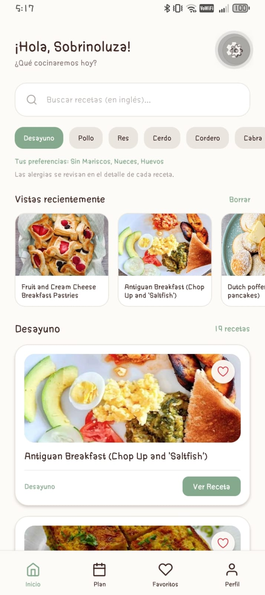
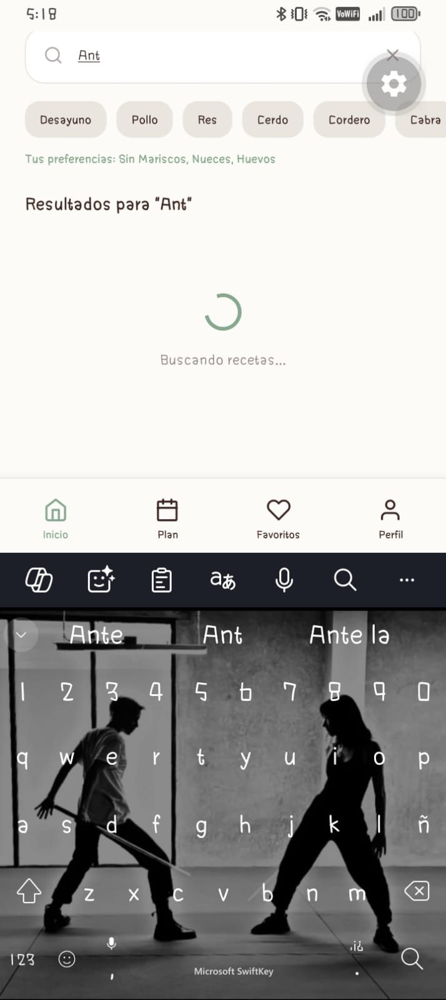
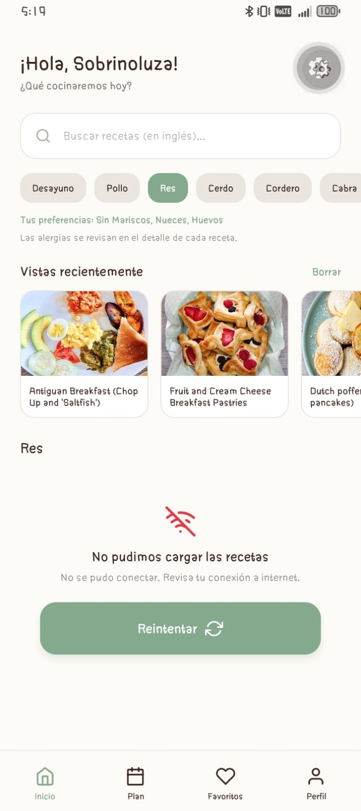
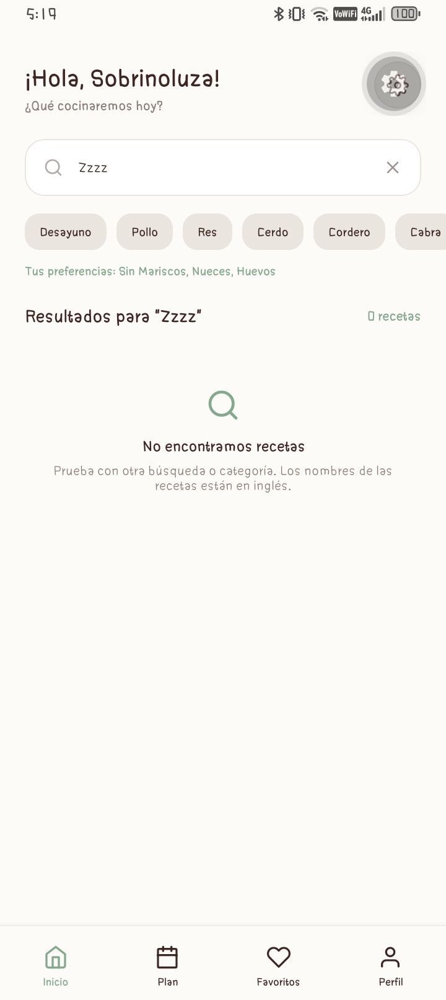
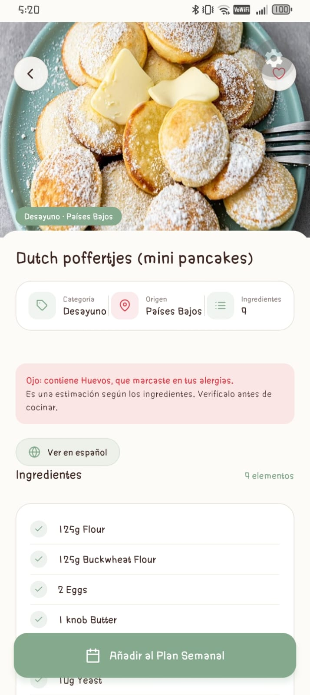
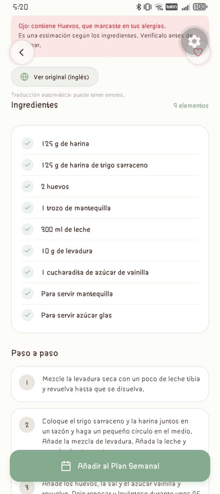
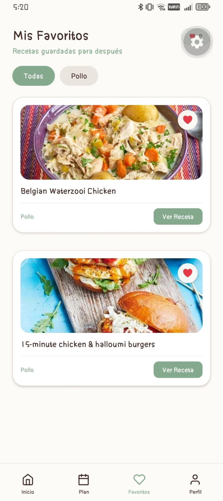
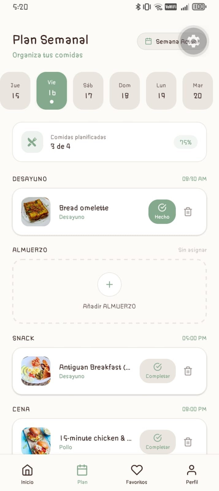
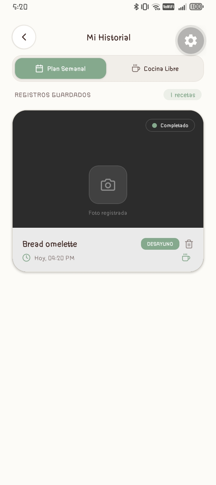
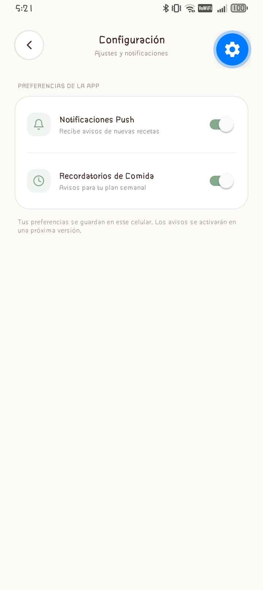

# FoodPlanner App 🥗🥘

Aplicación móvil (React Native + Expo) para **buscar recetas, guardar favoritas y organizar un plan semanal de comidas**, respetando la dieta y las alergias de cada usuario.

Proyecto del curso *Desarrollo de Aplicaciones Móviles* (proyecto 5 de la guía: FoodPlanner).

## 🎯 Estado del proyecto

| Avance | Estado | Alcance |
| ------ | ------ | ------- |
| **APF1** (semana 5) | ✅ Entregado y mejorado | Estructura, interfaz, props, estado, formulario validado y navegación |
| **APF2** (semana 10) | ✅ Entregado | Hooks, consumo de API, estados loading/error/vacío y AsyncStorage |
| APF3 (semana 15) | ⏳ Pendiente | Cámara, permisos y notificaciones locales |

## ✨ Funcionalidades actuales

- **Registro e inicio de sesión** con validación y mensajes de error visibles bajo cada campo.
- **Onboarding** (dieta → alergias). Desde el Perfil se pueden editar las mismas preferencias.
- **Inicio (conectado a la API):** recetas por categoría y búsqueda por nombre, con fotos reales. Muestra **cargando**, **error con botón de reintentar** y **estado vacío**. Se filtra según la dieta y alergias del usuario.
- **Detalle de receta (conectado a la API):** muestra al instante el nombre y la foto, y carga ingredientes y pasos. Avisa si la receta contiene algo que el usuario marcó como alergia.
- **Traducción al español (bajo demanda):** en el detalle, el botón **Traducir al español** traduce ingredientes y pasos (la API solo entrega inglés); el nombre del plato se conserva porque es un nombre propio. Muestra "Traduciendo...", mensajes de error con reintento y un aviso de que es traducción automática. Cada receta se traduce una sola vez: el resultado queda guardado en el celular y después se alterna con **Ver original / Ver en español** sin gastar cupo.
- **Favoritos:** el corazón funciona en Inicio, Detalle y Favoritos; los filtros se arman con las categorías de tus favoritos.
- **Vistas recientemente:** las últimas recetas que abriste aparecen en Inicio para volver a ellas rápido.
- **Todo se guarda en el celular (AsyncStorage):** la sesión, la dieta y alergias, los favoritos, las recetas vistas, el plan semanal, el historial de preparaciones y los ajustes. Al cerrar y abrir la app sigues dentro y no pierdes nada.
- **Plan semanal (persistente):** calendario de 19 días con 4 comidas por día (desayuno, almuerzo, snack, cena). Se agregan recetas desde el **detalle** ("Añadir al Plan Semanal": eliges día y comida) o desde el **Plan** (eliges entre tus favoritas y vistas). Se pueden abrir y quitar; los días con comidas se marcan con un punto y se muestra cuántas comidas del día están planificadas. Se guarda en AsyncStorage por usuario.
- **Registro de preparación e historial (persistentes):** al completar una comida del Plan (o desde el botón de cámara de una receta) se abre el registro y "Guardar en mi Historial" guarda la preparación con fecha y hora. El **Historial** separa *Plan Semanal* y *Cocina Libre*, muestra estado vacío y permite borrar registros; en el Plan, la comida completada queda marcada como "Hecho". La cámara sigue simulada hasta el APF3.
- **Perfil y ajustes (persistentes):** cierre de sesión que limpia el estado del usuario. En Configuración, los interruptores de notificaciones y recordatorios de comida se guardan por usuario; si apagas las notificaciones, los recordatorios quedan desactivados. Los avisos reales llegan en el APF3.

## 🌐 API: TheMealDB

Se usa [TheMealDB](https://www.themealdb.com/api.php) con la clave pública de pruebas (`1`). No requiere registro.

| Uso en la app | Endpoint |
| ------------- | -------- |
| Recetas de una categoría (Inicio) | `filter.php?c=<categoría>` |
| Buscar por nombre (Inicio) | `search.php?s=<texto>` |
| Receta completa (Detalle) | `lookup.php?i=<id>` |

**Datos que la API no entrega y cómo se resuelven:**

| Dato | Tratamiento |
| ---- | ----------- |
| Calorías, tiempo, porciones | No se muestran (no se inventan) |
| Dieta (vegetariano, vegano, pescatariano) | Se **estima** con la categoría y los ingredientes |
| Alérgenos (lactosa, gluten, huevos, mariscos, nueces) | Se **estiman** buscando palabras clave en los ingredientes. Es una ayuda, no una garantía |
| Dieta Keto | No se puede verificar (no hay datos de carbohidratos), por eso no filtra |
| Idioma | Nombres e instrucciones llegan en inglés; las categorías de la app están traducidas y el detalle de cada receta se puede traducir bajo demanda (ver sección Traducción) |

Las listas por categoría (`filter.php`) solo traen nombre y foto, así que las alergias se verifican en el detalle de cada receta, que sí trae los ingredientes.

## 🌍 Traducción: MyMemory

Se usa la API gratuita [MyMemory](https://mymemory.translated.net/doc/spec.php) (`en|es`), sin registro.

| Límite del servicio | Cómo se resuelve |
| ------------------- | ---------------- |
| 500 bytes por solicitud | Los pasos largos se parten por oraciones y los ingredientes se agrupan en pocas solicitudes |
| 5000 caracteres al día sin correo (50 000 con correo) | Solo se traduce al pulsar el botón y cada receta se guarda en caché. Si se agota el cupo, la app muestra un mensaje claro. Opcional: poner un correo propio en `CONTACT_EMAIL` (`src/services/translationService.js`) |
| Calidad de traducción automática | Se avisa en pantalla; la receta original siempre se puede ver |
| Errores típicos del traductor (`knob` → «perilla», `poffertjes` → «panqueques», mayúsculas raras) | Capa de mejora en `utils/translationGlossary.js`: (1) glosario culinario que reemplaza frases problemáticas antes de traducir, (2) lista de palabras que no se traducen (nombres de platos/utensilios) protegidas con marcadores, y (3) las **cantidades se traducen con un diccionario local** (`1 knob Butter` → `1 trozo de mantequilla`) y solo el nombre va a la API, normalizando mayúsculas |

Solo se traduce el **detalle** de la receta (ingredientes y pasos; el título se mantiene); las listas, el Plan y el Historial muestran los nombres originales.

## 🧱 Arquitectura

```
App.js                    # Punto de entrada: UserProvider + navegación
src/
├── components/           # Componentes reutilizables (ver tabla)
├── context/              # Estado global del usuario (UserContext)
├── data/                 # Categorías, orígenes en español, preferencias y comidas del día (mealSlots)
├── hooks/                # useRecipes, useRecipe, useDebouncedValue, useRecipeTranslation
├── navigation/           # Stack + Tabs (AppNavigator)
├── screens/              # Pantallas de la app
├── services/             # recipesService (API de recetas) y translationService (API de traducción)
├── storage/              # AsyncStorage: sesión y datos del usuario
├── theme/                # Paleta de colores única (colors.js)
└── utils/                # Glosario de traducción (translationGlossary), validaciones, filtros, conversión de datos de la API (mealMapper) y fechas del plan (plan.js)
```

**Flujo de datos:** pantalla → hook (`useRecipes` / `useRecipe`) → servicio (`fetch`) → `mealMapper` convierte la respuesta al formato de la app → la pantalla muestra cargando, error, vacío o la lista.

### Persistencia local (AsyncStorage)

| Archivo | Qué hace |
| ------- | -------- |
| `storage/storage.js` | Lee y guarda JSON sin que un error de lectura rompa la app (si el dato está dañado devuelve un valor por defecto) |
| `storage/userStorage.js` | Define qué se guarda y con qué clave, y **valida** lo leído antes de usarlo |
| `storage/translationStorage.js` | Caché de traducciones por receta (de todo el dispositivo); solo usa una traducción si coincide con la receta |
| `context/UserContext.js` | Al abrir la app recupera la sesión y los datos; cada cambio se guarda automáticamente |

Qué se guarda:

| Dato | Clave | Notas |
| ---- | ----- | ----- |
| Sesión (`name`, `email`) | `@foodplanner/v1/session` | Permite entrar directo a la app. Se borra al cerrar sesión |
| Dieta, alergias, favoritos, recetas vistas, plan semanal, historial y ajustes | `@foodplanner/v1/user/<correo>` | El plan es `{ "AAAA-MM-DD": { desayuno, almuerzo, snack, cena } }` y de cada receta solo guarda id, título, foto, categoría e ícono (el detalle se pide a la API). El historial guarda título, categoría, foto de la receta, origen (plan o libre), día/comida y fecha (máximo 100). Se guarda **por correo**: otra persona no ve tus favoritos, y si vuelves a entrar los recuperas. Máximo 20 recetas vistas |

Al abrir la app se muestra "Cargando tu cuenta..." mientras se lee lo guardado y después se decide la pantalla inicial: Inicio si hay sesión, Login si no.

### Hooks

| Hook | Qué hace |
| ---- | -------- |
| `useRecipes({ category, query })` | Pide la lista a la API con `useEffect`; devuelve `recipes`, `status` (`loading`/`success`/`error`), `error` y `reload`. Cancela la respuesta si la pantalla cambia de búsqueda |
| `useRecipe(id, initialRecipe)` | Pide una receta completa; muestra lo que ya se conoce mientras llega el resto |
| `useRecipeTranslation(recipe)` | Busca la traducción guardada al abrir la receta; `translate` la pide al servicio y la guarda. Devuelve `status`, `error`, `data` y `showSpanish` |
| `useDebouncedValue(value, delay)` | Espera a que el usuario deje de escribir antes de buscar, para no llamar a la API en cada letra |

### Componentes reutilizables

| Componente | Para qué sirve | Props principales |
| ---------- | -------------- | ----------------- |
| `Screen` | Contenedor base de cada pantalla (fondo, StatusBar, ancho máximo, `flex: 1`) | `style` |
| `ScreenHeader` | Cabecera con botón "volver", título y subtítulo | `title`, `subtitle`, `onBack`, `right` |
| `PrimaryButton` | Botón principal verde | `title`, `onPress`, `icon`, `size`, `disabled` |
| `Chip` | Opción seleccionable (dietas, alergias, categorías, filtros) | `label`, `selected`, `onPress`, `size` |
| `FormInput` | Campo con etiqueta, ícono, error y mostrar/ocultar contraseña | `label`, `icon`, `error`, `secureTextEntry` + props de `TextInput` |
| `BrandLogo` | Logo y nombre de la app | `subtitle`, `compact` |
| `EmptyState` | Mensaje para listas vacías o sin resultados | `icon`, `title`, `message` |
| `LoadingState` | Indicador de carga con mensaje | `message` |
| `ErrorState` | Mensaje de error con botón "Reintentar" | `title`, `message`, `onRetry` |
| `OnboardingStep` | Plantilla de cada paso del onboarding | `step`, `showDots`, `title`, `buttonLabel`, `onNext`, `feedback` |
| `RecipeImage` | Foto con spinner de carga e ícono de respaldo si falla | `uri`, `icon` |
| `AddToPlanModal` | Hoja para elegir día y comida al agregar una receta al plan | `visible`, `recipeTitle`, `plan`, `onClose`, `onConfirm` |
| `PickRecipeModal` | Hoja para elegir una receta (favoritas y vistas) para una comida | `visible`, `title`, `recipes`, `onClose`, `onSelect` |
| `RecipeCard` | Tarjeta de receta con foto y favorito | `title`, `image`, `tag`, `category`, `meta`, `isFavorite`, `onToggleFavorite`, `onViewRecipe` |

Todos se importan desde un solo lugar: `import { Screen, Chip } from '../components';`

**Flujo de navegación:** `Login ⇄ Register → DietaryPreferences → Allergies → MainTabs (Inicio · Plan · Favoritos · Perfil)` y desde las pestañas: `RecipeDetail`, `PreparationRecord`, `History`, `Settings`.

**Estado global (`UserContext`):** nombre, correo, dieta, alergias, favoritos (recetas completas), vistas y plan semanal, más `toggleFavorite`, `isFavorite`, `setMeal`, `removeMeal`, `signIn` y `signOut`.

**Estilos:** ningún color se escribe a mano en las pantallas; todos salen de `src/theme/colors.js`.

## 🛠️ Tecnologías

- React Native 0.86 · React 19 · Expo 57
- React Navigation (Native Stack + Bottom Tabs)
- Context API + hooks (`useState`, `useEffect`, `useContext`, `useMemo`, `useCallback`, `useRef`)
- `fetch` con `AbortController` (tiempo máximo de espera de 10 s)
- `@react-native-async-storage/async-storage`
- API de traducción MyMemory (`fetch` con tiempo máximo de 10 s)
- `@expo/vector-icons`

## ▶️ Instalación y ejecución

```bash
git clone https://github.com/NicoleSL37/FoodPlannerApp.git
cd FoodPlannerApp
npm install
npx expo start
```

Escanea el QR con **Expo Go** (Android/iOS) o presiona `a` para abrir el emulador de Android. **Se necesita conexión a internet** para cargar las recetas.

## 🧪 Cómo probar el flujo principal

1. Crea una cuenta (prueba enviar el formulario vacío para ver las validaciones).
2. Elige una dieta (por ejemplo *Vegetariano*) y una alergia (por ejemplo *Sin Gluten*).
3. En **Inicio**, cambia de categoría y busca una receta en inglés (por ejemplo `chicken`).
4. Apaga el internet y cambia de categoría: verás el mensaje de error; al volver a conectarte, pulsa **Reintentar**.
5. Abre una receta: verás la foto, los ingredientes, los pasos y el aviso de alérgenos.
6. Marca recetas con el corazón y revisa la pestaña **Favoritos**.
7. Abre varias recetas y revisa **Vistas recientemente** en Inicio.
8. **Cierra la app por completo y ábrela de nuevo:** debes seguir con la sesión iniciada y conservar favoritos, preferencias y recetas vistas.
9. Abre una receta, pulsa **Añadir al Plan Semanal**, elige día y comida y entra a **Plan**: la verás en ese día. Cierra la app por completo y ábrela: el plan sigue ahí. Prueba también **Añadir DESAYUNO** desde el Plan y el botón de quitar.
10. En **Plan**, pulsa **Completar** en una comida, toca el obturador y **Guardar en mi Historial**: la comida queda como "Hecho" y aparece en **Perfil → Historial** (pestaña Plan Semanal). Repite desde el botón de cámara de una receta para ver la pestaña Cocina Libre, y cierra y abre la app para comprobar que sigue ahí.
11. Abre una receta y pulsa **Traducir al español**: verás "Traduciendo..." y luego título, ingredientes y pasos en español. Pulsa **Ver original** para volver. Cierra la app, abre la misma receta y pulsa **Ver en español**: aparece al instante (viene de la caché). Con el internet apagado, prueba traducir otra receta: verás el mensaje de error y **Reintentar traducción**.
12. En **Perfil → Notificaciones**, apaga un interruptor, cierra la app por completo y ábrela: el ajuste sigue como lo dejaste.
13. En **Perfil**, cierra sesión e inicia con otro correo (verás que no tiene tus favoritos); vuelve a entrar con el primero y los recuperas.

## 📸 Evidencias

Capturas del avance 2 (guardadas en `docs/capturas/`). Cada una demuestra un criterio de la rúbrica.

| Criterio de la rúbrica | Captura | Qué muestra |
| ---------------------- | ------- | ----------- |
| Consumo de API y renderizado |  | Recetas de TheMealDB por categoría, con fotos reales y vistas recientemente |
| Estado de carga |  | «Buscando recetas...» mientras llega la respuesta |
| Estado de error |  | Mensaje con botón **Reintentar** (internet apagado) |
| Estado vacío |  | Búsqueda sin resultados |
| Consumo de API (detalle) |  | Ingredientes, pasos y aviso de alérgenos |
| API de traducción |  | Receta traducida al español, con «Ver original (inglés)» |
| AsyncStorage: favoritos |  | Favoritos que siguen al cerrar y abrir la app |
| AsyncStorage: plan semanal |  | Comidas planificadas por día |
| AsyncStorage: historial |  | Preparaciones registradas (Plan Semanal y Cocina Libre) |
| AsyncStorage: ajustes |  | Interruptores de notificaciones guardados |

## 🚧 Roadmap

**APF2**
- [x] Servicio de API de recetas (`src/services`) con `fetch`
- [x] Estados de carga, error (con reintento) y vacío en Inicio y Detalle
- [x] Persistencia con AsyncStorage (`src/storage`): sesión, preferencias, favoritos y recetas vistas
- [x] Plan semanal editable (asignar y quitar recetas por día y comida) y guardado en AsyncStorage
- [x] Historial de preparaciones persistido (registro, listado por origen, borrado y marca "Hecho" en el Plan)
- [x] Preferencias de Configuración persistidas (notificaciones y recordatorios)
- [x] Traducción al español de ingredientes y pasos (botón en el detalle, con caché y glosario culinario)

**APF3**
- [ ] Cámara real para registrar el platillo, con manejo de permisos
- [ ] Notificaciones locales de comidas planificadas
- [ ] Manejo de errores y logging básico

## 📄 Licencia

MIT
