# FoodPlanner App 🥗🥘

Aplicación móvil con React Native y Expo para descubrir recetas, guardar favoritas y organizar las comidas de la semana según las preferencias y alergias de cada usuario.

Proyecto del curso *Desarrollo de Aplicaciones Móviles* (proyecto 5 de la guía: FoodPlanner).

## Índice

1. [Descripción y propósito](#descripción-y-propósito)
2. [Estado de los avances](#estado-de-los-avances)
3. [Funcionalidades](#funcionalidades)
4. [Flujo integrado](#flujo-integrado)
5. [Arquitectura](#arquitectura)
6. [Funcionalidad nativa](#funcionalidad-nativa)
7. [Permisos](#permisos)
8. [Notificaciones](#notificaciones)
9. [Errores, validaciones y registro](#errores-validaciones-y-registro)
10. [Casos de prueba APF3](#casos-de-prueba-apf3)
11. [Evidencias](#evidencias)
12. [Instalación, ejecución y builds](#instalación-ejecución-y-builds)
13. [Limitaciones y mejoras futuras](#limitaciones-y-mejoras-futuras)
14. [Tecnologías](#tecnologías)
15. [Roadmap](#roadmap)
16. [Licencia](#licencia)

## Descripción y propósito

FoodPlanner está dirigida a personas que quieren explorar recetas y planificar sus comidas. Permite filtrar según preferencias y alergias, conservar recetas favoritas, llevar un plan semanal y registrar las preparaciones realizadas.

Las pantallas actuales incluyen acceso y registro, selección de dieta y alergias, Inicio, detalle de receta, Favoritos, Plan, Registro de Preparación, Historial, Perfil y Configuración. Configuración incluye el acceso al Diagnóstico y al registro de eventos.

## Estado de los avances

| Avance | Estado | Entregas |
| ------ | ------ | -------- |
| APF1 (semana 5) | ✅ Entregado y mejorado | Estructura e interfaz, componentes y props, estado, formularios validados y navegación |
| APF2 (semana 10) | ✅ Entregado | Hooks, consumo de API, estados de carga/error/vacío, almacenamiento local, plan semanal, historial y traducción bajo demanda |
| APF3 (semana 15) | ✅ Completado | Cámara y permisos, notificaciones locales, validaciones, manejo de errores y registro, integración global y documentación |

## Funcionalidades

### APF1 y APF2

- **Acceso y preferencias:** registro e inicio de sesión con validación; onboarding de dieta y alergias; edición de preferencias desde Perfil.
- **Inicio:** recetas por categoría y búsqueda por nombre desde TheMealDB. Presenta estados de carga, error con reintento y vacío; aplica filtros de dieta y alergias estimados a partir de los datos disponibles.
- **Detalle:** muestra receta, ingredientes y pasos; presenta avisos relacionados con las alergias indicadas por el usuario.
- **Favoritos y vistas recientes:** las recetas favoritas se consultan desde Favoritos y las últimas recetas abiertas aparecen en Inicio.
- **Traducción:** en Detalle se pueden traducir al español ingredientes y pasos. El título se conserva; el resultado se almacena en caché local para consultarlo después.
- **Persistencia:** AsyncStorage conserva la sesión, preferencias, favoritos, vistas recientes, plan semanal, historial y ajustes. Los datos principales se separan por usuario; la caché de traducciones es del dispositivo.
- **Plan semanal:** calendario de 19 días y cuatro comidas diarias (desayuno, almuerzo, snack y cena). Se agregan recetas desde Detalle o desde el Plan, se pueden quitar y abrir, y las preparaciones completadas se marcan en el plan.
- **Historial:** diferencia Plan Semanal y Cocina Libre, muestra las preparaciones y permite borrarlas.

### APF3

- Registro de preparación mediante cámara real, con foto opcional persistida dentro del espacio privado de la aplicación.
- Solicitud contextual y gestión de permisos para cámara y notificaciones.
- Recordatorios locales para comidas planificadas, con opción de notificación de prueba y navegación desde el aviso.
- Validaciones de entradas y flujos, manejo controlado de errores y registro central consultable desde Diagnóstico.

## Flujo integrado

El recorrido principal enlaza la búsqueda con la planificación, preparación e historial. El recordatorio es independiente de la captura: la comida puede registrarse con o sin foto.

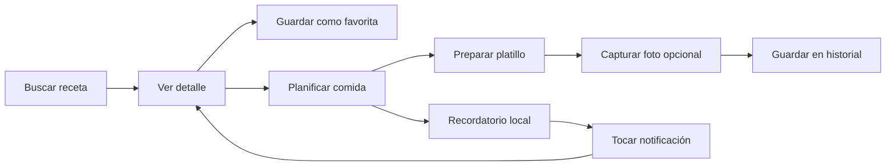

## Arquitectura

### Estructura de `src/`

```text
src/
├── components/             # Componentes reutilizables, tarjetas, imágenes, modales y ErrorBoundary
├── context/UserContext.js  # Estado global y acciones de usuario, plan e historial
├── data/                   # mealSlots, categorías, áreas y preferencias
├── hooks/                  # Hooks de recetas, permisos, traducción y búsqueda con demora
├── navigation/             # AppNavigator, pestañas, rutas y navegación desde notificaciones
├── screens/                # Login, Register, preferencias, Home, Plan, detalle, Favoritos,
│                           # preparación, Historial, Perfil, Configuración y Diagnóstico
├── services/               # API de recetas, traducción, permisos y notificaciones
├── storage/                # Persistencia JSON, validación de usuario y caché de traducciones
├── theme/colors.js         # Paleta de colores
└── utils/                  # Logger, validadores, plan, filtros y transformación de recetas
```

Las pantallas presentan la interfaz; los componentes reúnen piezas visuales; los hooks gestionan lógica reutilizable de interfaz; los servicios encapsulan API y capacidades del dispositivo; `UserContext` coordina el estado de usuario y sus acciones; `storage` lee y persiste datos; `utils` ofrece lógica compartida.

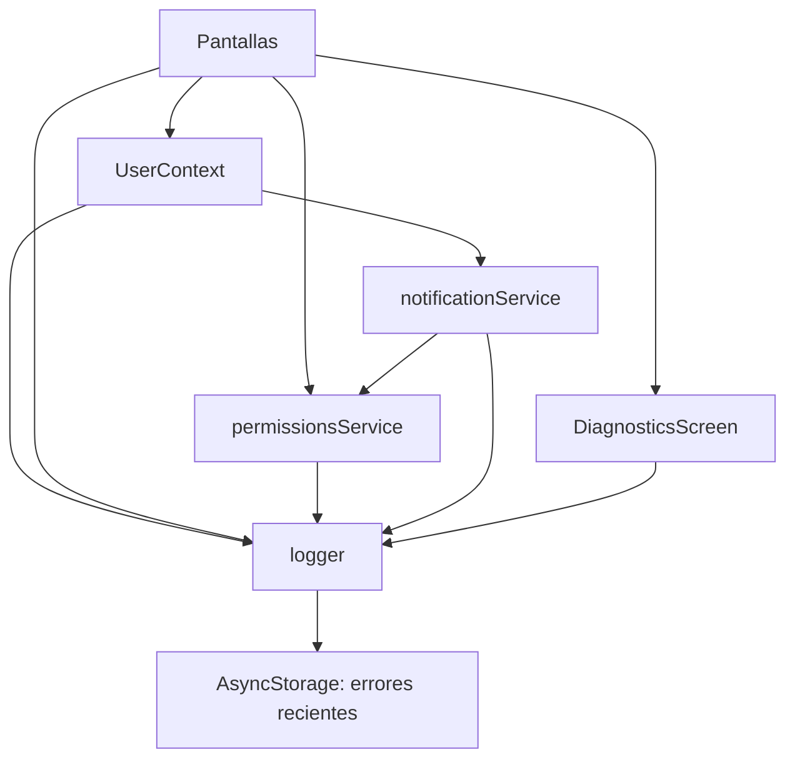

### API, traducción y persistencia

La aplicación usa [TheMealDB](https://www.themealdb.com/api.php) con su clave pública de prueba (`1`), sin registro.

| Uso | Ruta consultada |
| --- | -------------- |
| Recetas por categoría | `filter.php?c=<categoría>` |
| Búsqueda por nombre | `search.php?s=<texto>` |
| Detalle de receta | `lookup.php?i=<id>` |

TheMealDB no entrega calorías, duración ni porciones; esos datos no se inventan ni se muestran. La clasificación de dieta y alérgenos se estima a partir de categorías e ingredientes. Keto no se puede verificar con los datos de carbohidratos disponibles. Las recetas de categoría traen información resumida; el detalle se consulta para acceder a ingredientes y pasos.

| Dato que no entrega la API | Tratamiento |
| -------------------------- | ----------- |
| Calorías, tiempo y porciones | No se muestran |
| Dietas vegetariana, vegana y pescatariana | Se estiman desde categoría e ingredientes |
| Alérgenos (lactosa, gluten, huevo, mariscos y nueces) | Se estiman por palabras clave en ingredientes; no son una garantía |
| Dieta Keto | No se filtra porque no hay datos de carbohidratos |
| Idioma | Nombres e instrucciones se reciben en inglés; las categorías de la app se traducen y el detalle admite traducción bajo demanda |

MyMemory se usa para la traducción automática inglés-español. El servicio limita cada solicitud a 500 bytes y publica un cupo gratuito diario de 5.000 caracteres (50.000 con correo). La aplicación divide textos largos por oraciones y agrupa ingredientes, guarda traducciones localmente y presenta errores si el servicio no responde o se agota el cupo. `translationGlossary.js` contiene equivalencias culinarias, correcciones de términos problemáticos, marcadores para nombres que no se deben traducir y traducción local de ciertas cantidades/unidades. La traducción solo se solicita desde Detalle; las listas, Plan e Historial conservan los títulos originales.

| Archivo de almacenamiento | Función |
| ------------------------- | ------- |
| `storage/storage.js` | Lectura y escritura de JSON con recuperación ante errores |
| `storage/userStorage.js` | Claves y validación de sesión y datos por usuario |
| `storage/translationStorage.js` | Caché local de traducciones por identificador de receta |
| `context/UserContext.js` | Hidrata los datos y guarda cambios del usuario |

La sesión se conserva en `@foodplanner/v1/session`; los datos de usuario se guardan bajo `@foodplanner/v1/user/<correo>`. El plan contiene días con comidas y recetas resumidas. El historial admite hasta 100 entradas; las vistas recientes, hasta 20. La caché de traducción está separada por receta y no por usuario.

### Hooks y componentes reutilizables

| Hook | Uso |
| ---- | --- |
| `useRecipes({ category, query })` | Consulta una categoría o busca por nombre; informa estado, error y función para reintentar |
| `useRecipe(id, initialRecipe)` | Obtiene el detalle completo y aprovecha datos iniciales si están disponibles |
| `useRecipeTranslation(recipe)` | Lee la caché, solicita la traducción y alterna entre original y traducida |
| `useDebouncedValue(value, delay)` | Reduce consultas mientras cambia el texto de búsqueda |
| `usePermission(kind)` | Comprueba/solicita permisos y actualiza su estado al volver la app al primer plano |

Entre los componentes reutilizables están `Screen`, `ScreenHeader`, `PrimaryButton`, `Chip`, `FormInput`, `BrandLogo`, `EmptyState`, `LoadingState`, `ErrorState`, `OnboardingStep`, `RecipeImage`, `AddToPlanModal`, `PickRecipeModal` y `RecipeCard`. Se exportan desde `src/components/index.js`.

| Componente | Uso y propiedades principales |
| ---------- | ----------------------------- |
| `Screen`, `ScreenHeader` | Contenedor de pantalla y cabecera (`title`, `subtitle`, `onBack`, `right`) |
| `PrimaryButton` | Botón principal (`title`, `onPress`, `icon`, `size`, `disabled`) |
| `Chip` | Opción seleccionable (`label`, `selected`, `onPress`, `size`) |
| `FormInput` | Campo con etiqueta, ícono, error y opciones de `TextInput` |
| `BrandLogo` | Marca (`subtitle`, `compact`) |
| `EmptyState`, `LoadingState`, `ErrorState` | Estados vacío, carga y error con reintento |
| `OnboardingStep` | Paso de onboarding (`step`, `title`, `buttonLabel`, `onNext`, `feedback`) |
| `RecipeImage` | Imagen con indicador de carga y respaldo (`uri`, `icon`) |
| `AddToPlanModal`, `PickRecipeModal` | Selección de día/comida o receta (`visible`, `plan`/`recipes`, `onClose`, `onConfirm`/`onSelect`) |
| `RecipeCard` | Tarjeta de receta con foto, favorito y acciones |

La navegación principal es `Login → Register/Preferencias → MainTabs` (Inicio, Plan, Favoritos y Perfil). Desde las pestañas se abren Detalle, Registro de Preparación, Historial y Configuración.

## Funcionalidad nativa

`expo-camera` proporciona la vista previa (`CameraView`), captura, cambio entre cámara trasera y frontal, y flash. `expo-file-system` copia la foto elegida a `Paths.document/fotos-preparaciones`; el historial conserva `photoUri` y `hasPhoto`. Al borrar una entrada, el contexto intenta borrar su archivo. Las entradas antiguas o guardadas sin foto siguen mostrándose con un respaldo visual.

La cámara se solicita al entrar en Registro de Preparación, no al iniciar la aplicación. Si no se concede, sigue disponible el flujo para guardar la preparación sin foto.

## Permisos

Los permisos se solicitan al usar la capacidad correspondiente. `usePermission` vuelve a comprobar el estado cuando la aplicación regresa al primer plano.

| Permiso | Cuándo se solicita | Si se acepta | Si se rechaza | Si se bloquea |
| ------- | ------------------ | ------------ | ------------- | ------------- |
| Cámara | Al entrar a Registro de Preparación | Aparece la vista previa y se puede capturar | Se explica que hace falta el permiso; permite reintentar o guardar sin foto | Muestra acceso a ajustes; el registro sin foto sigue disponible |
| Notificaciones | Al activar «Notificaciones Push» en Configuración | Se puede activar el ajuste y habilitar recordatorios | El ajuste queda apagado y se muestra un aviso con acciones de reintento y ajustes | El aviso permite abrir los ajustes; al regresar se comprueba de nuevo el permiso |

En `app.json`, los textos de cámara están en español: «FoodPlanner necesita acceder a la cámara para fotografiar el platillo preparado.» para iOS (`NSCameraUsageDescription`) y el complemento de cámara. El complemento de notificaciones declara `enableRemoteNotifications: false`; `app.json` no configura un texto de uso personalizado para notificaciones. La explicación del permiso se presenta en Configuración.

## Notificaciones

Solo se programan notificaciones **locales**. `REMINDER_MINUTES_BEFORE` vale 15 y los horarios fijos por comida se encuentran en `src/data/mealSlots.js`. En Android, el canal es `recordatorios-comidas`, con nombre «Recordatorios de comidas» e importancia alta.

| Evento | Acción |
| ------ | ------ |
| Se agrega o cambia una comida del plan | Programa o reemplaza su recordatorio si ambos ajustes están activos y el permiso está concedido |
| La hora del recordatorio ya pasó | Omite la notificación; no bloquea el guardado de la comida |
| Se quita una comida o se registra como preparada | Cancela el recordatorio de esa comida |
| Se apagan los recordatorios o las notificaciones | Cancela los recordatorios del usuario |
| Se inicia sesión o se recupera la sesión guardada | Sincroniza recordatorios futuros y omite comidas registradas como preparadas |
| Se toca una notificación | Abre el detalle si hay identificador de receta; en otro caso navega al Plan |

Configuración incluye «Enviar notificación de prueba», que agenda un aviso local para aproximadamente cinco segundos después. La prueba de notificaciones requiere development build o APK; Expo Go tiene limitaciones.

## Errores, validaciones y registro

`src/utils/logger.js` usa el formato `[fecha ISO] [NIVEL] [módulo] mensaje`; las marcas ISO están en UTC. `INFO` registra eventos relevantes, `WARN` situaciones recuperables, `ERROR` fallos y `DEBUG` solo se imprime durante desarrollo. Se guardan hasta 100 eventos en memoria y hasta 50 errores en AsyncStorage. El logger enmascara correos y oculta campos sensibles.

| Módulo | Eventos registrados |
| ------ | ------------------- |
| `app` | Inicio, recuperación/inicio/cierre de sesión y errores globales o del ErrorBoundary |
| `permisos` | Comprobación, solicitud, resultado y errores |
| `camara` | Captura, guardado y problemas con archivos de foto |
| `notificaciones` | Programación, cancelación, omisiones y sincronización con conteos |
| `red` | Tiempo agotado, desconexión, errores de respuesta y cuota de traducción |
| `almacenamiento` | Errores de lectura/escritura/borrado y recuperación con valores predeterminados |
| `navegacion` | Fallos al procesar respuestas de notificación |
| `plan` / `historial` | Validaciones de planificación y problemas de fotos |

`ErrorBoundary` captura errores de renderizado, los registra con la pila de componentes y muestra recuperación con «Reintentar» y, si la navegación está disponible, «Volver al inicio». El manejador global de errores JavaScript registra fallos no capturados y delega al manejador anterior de React Native.

| Pantalla o flujo | Validación | Respuesta |
| --------------- | ---------- | -------- |
| Plan / Detalle | La receta debe tener identificador | Rechaza recetas inválidas con un mensaje claro |
| Plan / Detalle | Un horario ocupado requiere confirmación | Pregunta antes de reemplazar la comida |
| Plan | Hora de recordatorio pasada | Guarda la comida e informa «Este horario ya pasó, no se programará recordatorio» |
| Preparación | Verifica que `photoUri` exista | Si falta, avisa y permite guardar sin foto; evita doble toque durante el guardado |
| Login / Registro | Datos obligatorios, correo y contraseñas válidos | Muestra errores; no inicia ni crea sesión con entradas inválidas |
| Preferencias | Selección válida | Informa si falta una selección requerida |
| Red / traducción | Timeout de 10 s y respuesta válida | Muestra error con reintento; distingue «Sin conexión a internet» |
| Almacenamiento | JSON leído de AsyncStorage | Ante datos corruptos usa valores predeterminados y registra el error |

Optimizaciones presentes: `FlatList` para Historial, cantidad inicial acotada y recorte de vistas en Android; `React.memo` para tarjetas de listas; callbacks estabilizados en listas; `useMemo` para el valor del contexto; respaldo para imágenes; limpieza de listeners y suscripciones en los efectos correspondientes.

Desde **Configuración → Diagnóstico → Ver registro de eventos** se puede consultar el historial reciente y filtrarlo por nivel. «Borrar registro» pide confirmación y borra los registros en memoria y los errores persistidos.

## Casos de prueba APF3

| ID | Caso | Pasos | Resultado esperado | Estado |
| -- | ---- | ----- | ------------------ | ------ |
| P01 | Captura y guardado de foto | Capturar, usar la foto y guardar el registro | El historial muestra la fotografía | ✅ Probado en celular |
| P02 | Foto tras reiniciar | Guardar foto y reiniciar la app | La foto continúa en el historial | ✅ Probado en celular |
| P03 | Borrar registro con foto | Borrar el registro desde Historial | Se borra el registro y se intenta borrar el archivo | ✅ Probado en celular |
| P04 | Cámara concedida | Entrar al registro y aceptar | Se muestra la vista previa | ✅ Probado en celular |
| P05 | Cámara denegada | Denegar el permiso | Se muestra el estado alternativo | ✅ Probado en celular |
| P06 | Cámara bloqueada | Bloquear el permiso y abrir ajustes | Se ofrece «Abrir ajustes» | ✅ Probado en celular |
| P07 | Notificaciones concedidas | Activar el ajuste y aceptar | El permiso queda concedido | ✅ Probado en celular |
| P08 | Notificaciones denegadas | Denegar al activar el ajuste | El interruptor queda apagado y se informa al usuario | ✅ Probado en celular |
| P09 | Notificación de prueba | Pulsar el botón de prueba | Llega el aviso local en unos segundos | ✅ Probado en celular |
| P10 | Recordatorio real de comida | Planificar una comida futura con recordatorios activos | Llega el recordatorio local | ✅ Probado en celular |
| P11 | Cancelar al quitar comida | Quitar una comida planificada | Se cancela su recordatorio | ✅ Probado en celular |
| P12 | Sin conexión | Desconectar internet y consultar recetas | Se muestra el mensaje de falta de conexión | ✅ Probado en celular |
| P13 | ErrorBoundary | Provocar una excepción capturable | Aparece la pantalla de recuperación | ✅ Probado en celular |
| P14 | Registro, filtros y borrado | Filtrar eventos y borrar el registro tras confirmar | Se muestran resultados filtrados y se borra el registro | ✅ Probado en celular |
| P15 | Hora pasada | Planificar una comida cuyo horario ya pasó | Se guarda y se informa que no habrá recordatorio | ✅ Probado en celular |
| P16 | Cambiar cámara y flash | Probar controles del visor | Cambia de cámara y alterna el flash trasero | ✅ Probado en celular |
| P17 | Repetir foto | Capturar y elegir repetir | Permite tomar otra imagen antes de guardarla | ✅ Probado en celular |
| P18 | Guardar sin foto | Denegar cámara y completar el registro | Se registra sin fotografía | ✅ Probado en celular |
| P19 | Abrir receta desde notificación | Tocar un recordatorio que tenga receta | Se abre el detalle correspondiente | ✅ Probado en celular |
| P20 | Notificación sin receta | Abrir una respuesta sin identificador de receta | Navega al Plan | ✅ Probado en celular |
| P21 | Confirmar reemplazo | Planificar una receta en un horario ocupado | Se solicita confirmación | ✅ Probado en celular |
| P22 | Formularios vacíos o inválidos | Revisar validaciones de acceso y registro | Los errores impiden guardar o iniciar sesión con datos inválidos | Verificado por revisión de código (sin prueba en celular) |
| P23 | AsyncStorage con JSON corrupto | Revisar la recuperación ante datos JSON inválidos | Registra error y usa valores predeterminados | Verificado por revisión de código (sin prueba en celular) |
| P24 | APK instalado | Instalar el APK de vista previa y abrir la app | La aplicación arranca desde el APK instalado | ✅ Probado en celular |

## Evidencias

### APF2

Las capturas existentes están en `docs/capturas/`.

| Criterio | Captura | Qué muestra |
| -------- | ------- | ----------- |
| Recetas y renderizado | 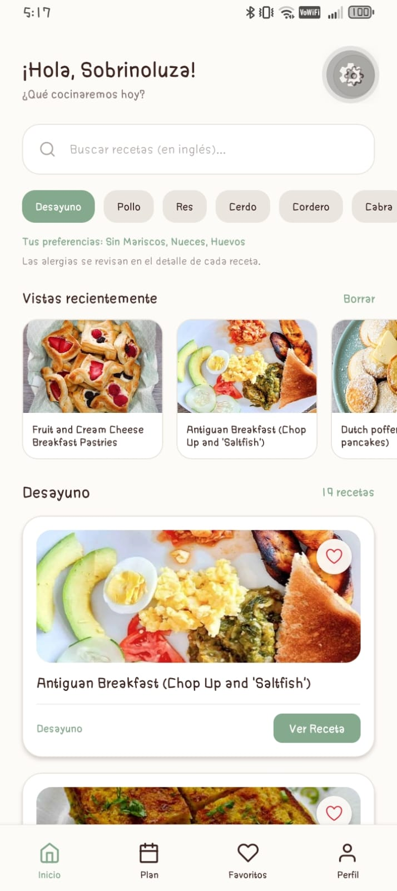 | Recetas por categoría y vistas recientes |
| Carga | 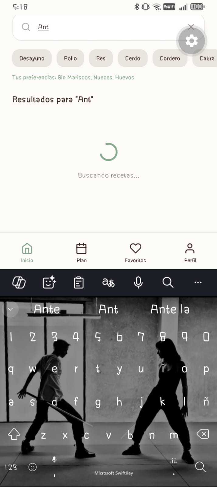 | Estado de búsqueda mientras llega la respuesta |
| Error | 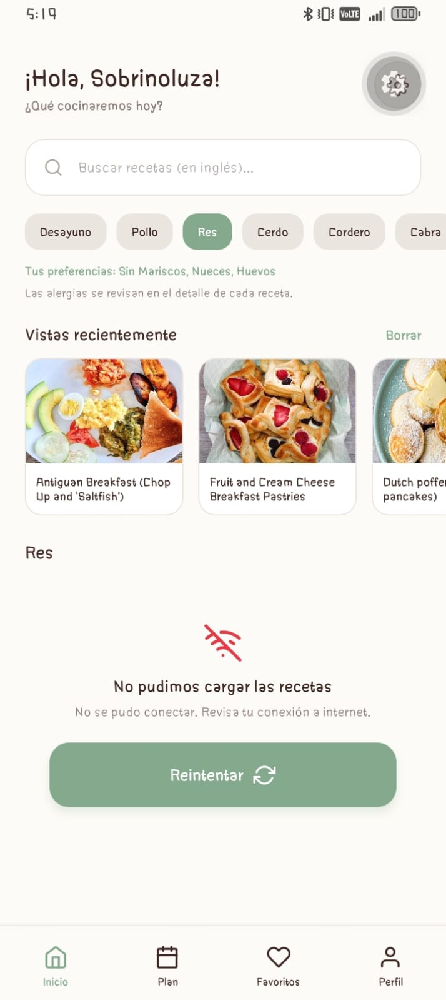 | Mensaje y acción para reintentar |
| Estado vacío | 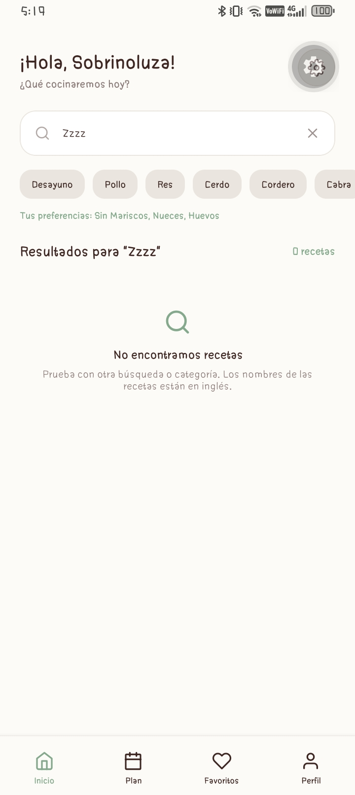 | Búsqueda sin resultados |
| Detalle | 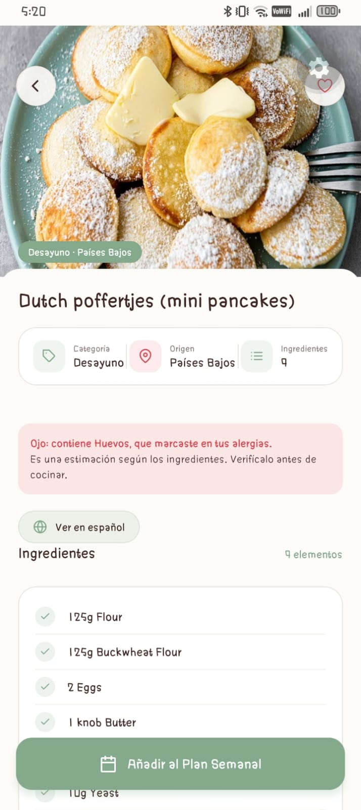 | Ingredientes, pasos y aviso de alérgenos |
| Traducción | 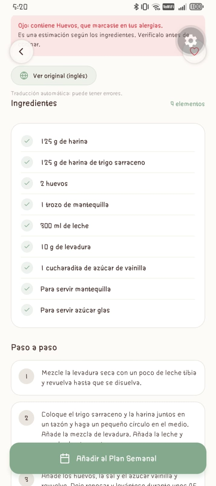 | Receta traducida |
| Persistencia de favoritos | 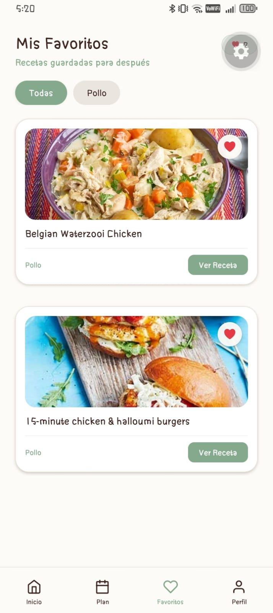 | Favoritos conservados |
| Persistencia del Plan | 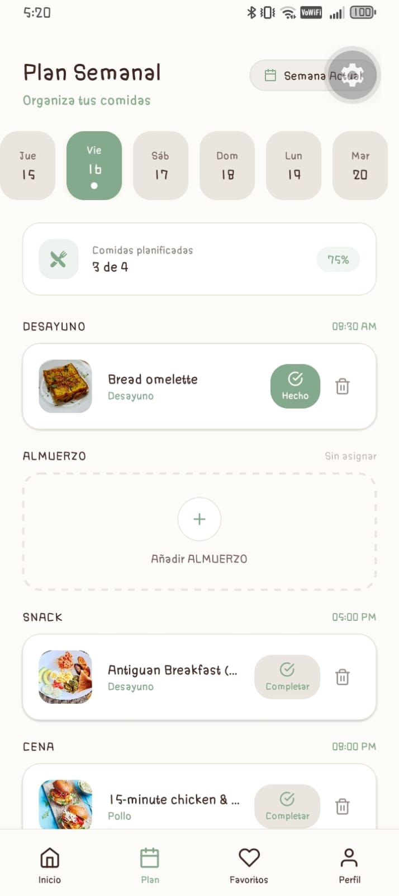 | Comidas del plan semanal |
| Persistencia del Historial | 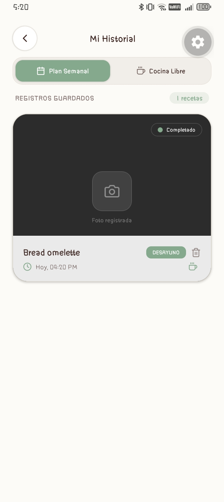 | Preparaciones registradas |
| Persistencia de ajustes | 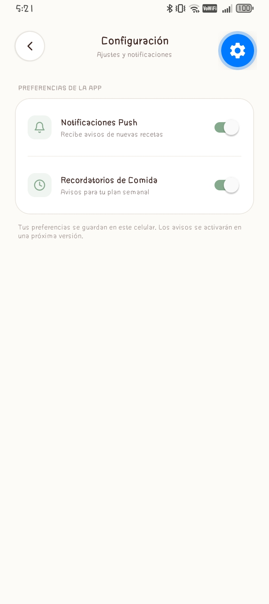 | Ajustes de notificaciones |

### APF3

Las capturas esperadas se guardan en `docs/capturas/apf3/`. El [índice de evidencias](docs/capturas/apf3/README.md) describe cada nombre; las imágenes deben agregarse cuando estén disponibles.

| Captura esperada | Qué debe mostrar |
| ---------------- | ---------------- |
| [01-camara-vista-previa.png](docs/capturas/apf3/01-camara-vista-previa.png) | Vista previa de cámara en el registro |
| [02-foto-capturada-repetir-usar.png](docs/capturas/apf3/02-foto-capturada-repetir-usar.png) | Foto capturada y opciones para repetir o usar |
| [03-historial-con-foto.png](docs/capturas/apf3/03-historial-con-foto.png) | Registro del Historial con foto |
| [04-permiso-camara-dialogo.png](docs/capturas/apf3/04-permiso-camara-dialogo.png) | Diálogo de permiso de cámara |
| [05-permiso-camara-denegado.png](docs/capturas/apf3/05-permiso-camara-denegado.png) | Estado de cámara denegada |
| [06-permiso-camara-ajustes-sistema.png](docs/capturas/apf3/06-permiso-camara-ajustes-sistema.png) | Ajustes del sistema para cámara |
| [07-permiso-notificaciones-dialogo.png](docs/capturas/apf3/07-permiso-notificaciones-dialogo.png) | Diálogo de permiso de notificaciones |
| [08-permiso-notificaciones-bloqueado.png](docs/capturas/apf3/08-permiso-notificaciones-bloqueado.png) | Aviso de permiso bloqueado y acceso a ajustes |
| [09-configuracion-notificaciones.png](docs/capturas/apf3/09-configuracion-notificaciones.png) | Ajustes y acción de notificación de prueba |
| [10-plan-con-recordatorio.png](docs/capturas/apf3/10-plan-con-recordatorio.png) | Comida planificada con indicador de recordatorio |
| [11-notificacion-recordatorio.png](docs/capturas/apf3/11-notificacion-recordatorio.png) | Notificación local recibida |
| [12-notificacion-abre-receta.png](docs/capturas/apf3/12-notificacion-abre-receta.png) | Receta abierta desde la notificación |
| [13-diagnostico-configuracion.png](docs/capturas/apf3/13-diagnostico-configuracion.png) | Diagnóstico en Configuración |
| [14-registro-eventos.png](docs/capturas/apf3/14-registro-eventos.png) | Lista de eventos recientes |
| [15-registro-eventos-filtro-error.png](docs/capturas/apf3/15-registro-eventos-filtro-error.png) | Registro filtrado por errores |
| [16-error-boundary.png](docs/capturas/apf3/16-error-boundary.png) | Pantalla de recuperación del ErrorBoundary |
| [17-sin-conexion.png](docs/capturas/apf3/17-sin-conexion.png) | Mensaje por falta de conexión |
| [18-validacion-hora-pasada.png](docs/capturas/apf3/18-validacion-hora-pasada.png) | Aviso para un horario ya pasado |
| [19-flujo-buscar.png](docs/capturas/apf3/19-flujo-buscar.png) | Búsqueda de recetas en Inicio |
| [20-flujo-detalle.png](docs/capturas/apf3/20-flujo-detalle.png) | Detalle de una receta |
| [21-flujo-plan.png](docs/capturas/apf3/21-flujo-plan.png) | Receta planificada |
| [22-flujo-registro-preparacion.png](docs/capturas/apf3/22-flujo-registro-preparacion.png) | Registro de preparación |
| [23-flujo-historial.png](docs/capturas/apf3/23-flujo-historial.png) | Preparación en Historial |
| [24-apk-instalado.png](docs/capturas/apf3/24-apk-instalado.png) | App abierta desde un APK instalado |

## Instalación, ejecución y builds

Requisitos: Node.js/npm y acceso a internet para instalar paquetes, consultar recetas y traducir.

```bash
git clone https://github.com/NicoleSL37/FoodPlannerApp.git
cd FoodPlannerApp
npm install
npx expo start --dev-client
```

Para las capacidades nativas, especialmente notificaciones locales, usa un development build o el APK de vista previa; Expo Go tiene limitaciones con las notificaciones. Con EAS CLI configurado, genera los builds de Android así:

```bash
eas build --platform android --profile development
eas build --platform android --profile preview
```

El perfil `development` usa un cliente de desarrollo. `preview` distribuye un APK interno sin `developmentClient`, instalable y ejecutable sin un servidor de desarrollo.

## Limitaciones y mejoras futuras

- Las notificaciones son locales; la app no implementa notificaciones push remotas.
- La entrega puede depender de los permisos del sistema y de restricciones de ahorro de batería del dispositivo.
- Los horarios de comidas son fijos en `src/data/mealSlots.js`.
- TheMealDB entrega recetas en inglés; la traducción es bajo demanda y depende de un servicio externo con cupo.
- Las dietas y los alérgenos se estiman con los datos de la receta y no equivalen a una verificación nutricional.

## Tecnologías

Versiones declaradas en `package.json`:

| Paquete | Versión |
| ------- | ------- |
| Expo | `^58.0.0` (SDK 58) |
| React Native | `0.88.1` |
| React | `19.3.0` |
| `expo-camera` | `~58.0.14` |
| `expo-file-system` | `~58.0.13` |
| `expo-notifications` | `~58.1.9` |
| `expo-constants` | `~58.0.16` |
| `@react-navigation/native` | `^7.3.18` |
| `@react-navigation/native-stack` | `^7.18.10` |
| `@react-navigation/bottom-tabs` | `^7.18.18` |
| AsyncStorage | `2.2.0` |
| `@expo/vector-icons` | `^15.1.1` |

También se usan Context API, hooks de React, `fetch` con `AbortController` y servicios externos TheMealDB y MyMemory. El proyecto corresponde al curso *Desarrollo de Aplicaciones Móviles*, proyecto 5 de la guía: FoodPlanner; el README original no registra nombres individuales del equipo.

## Roadmap

No hay tareas pendientes registradas para APF3. Las posibilidades de mejora futuras se describen en [Limitaciones y mejoras futuras](#limitaciones-y-mejoras-futuras).

## Licencia

MIT
